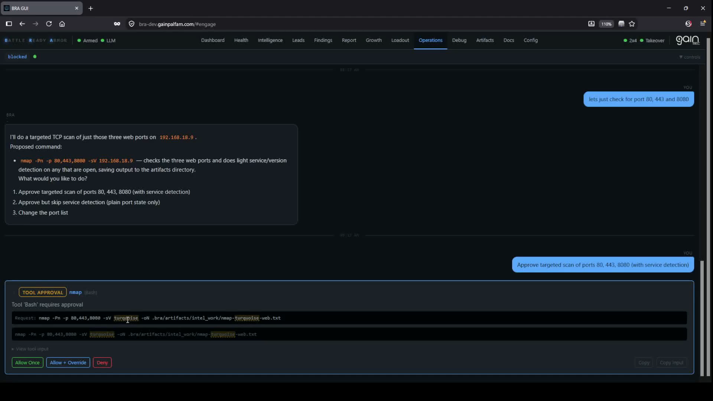
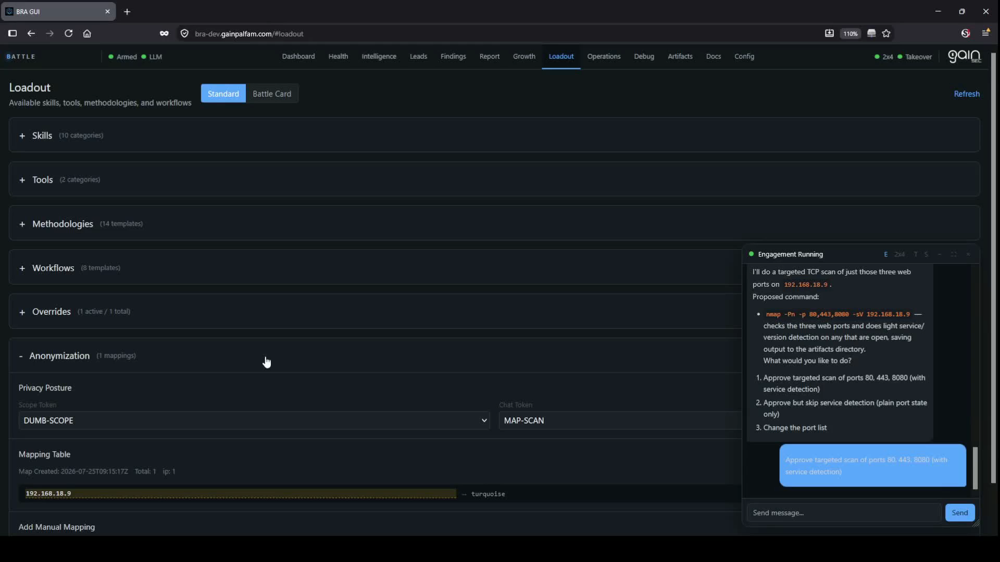
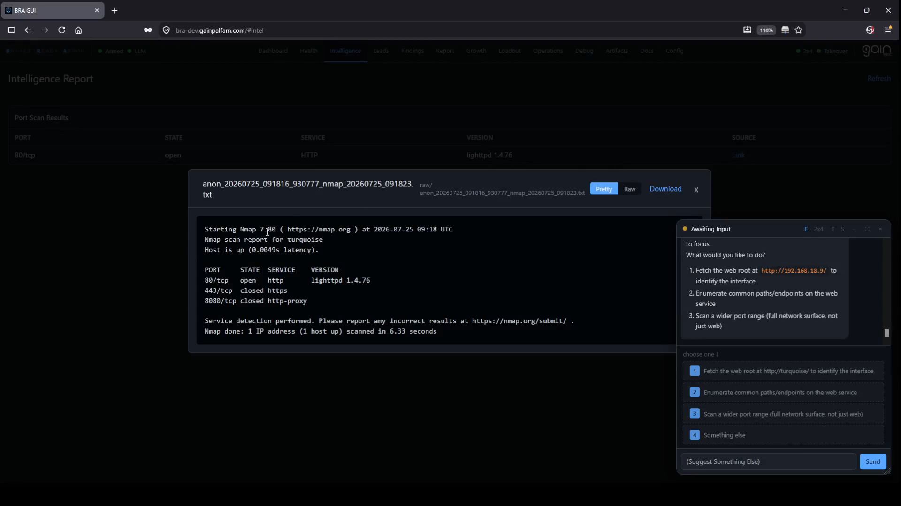
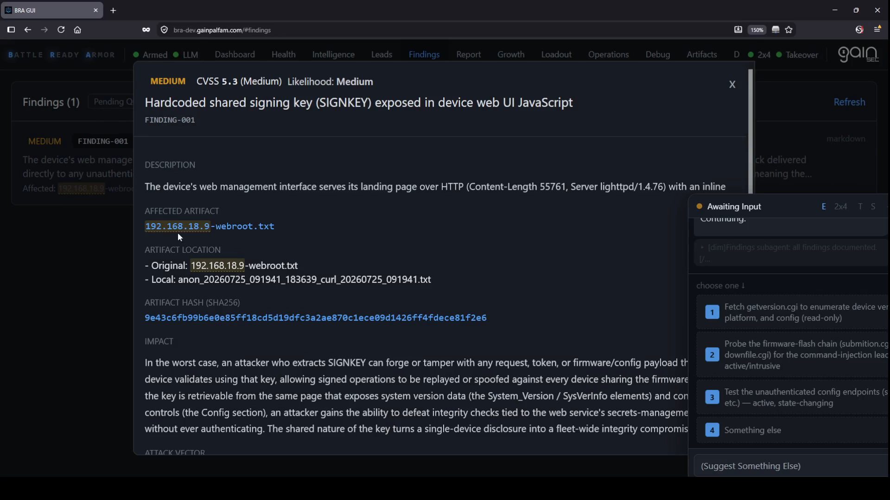
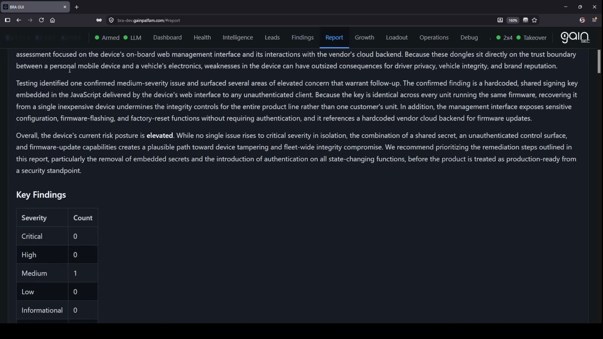
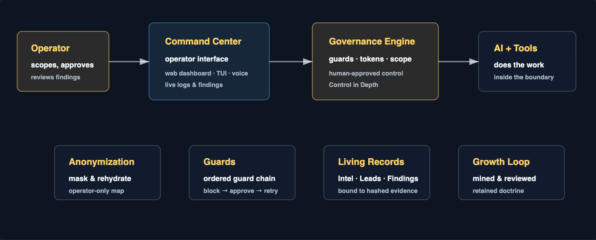
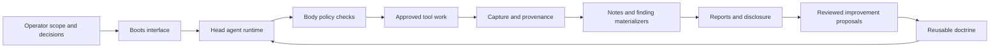

# Battle Ready Armor

Battle Ready Armor (BRA) is a self-hosted control plane for AI-assisted security assessment.

**The model supplies reasoning. Your tools supply capability. BRA connects their use to operator authority and retained knowledge.**

A security team needs to delegate analysis while retaining decisions about targets, activity, evidence, and disclosure.
It also needs useful methods to remain available when operators or model backends change.
BRA brings those responsibilities into one governed engagement.
It runs directly on the host without requiring a separate virtual machine or container.

Think of BRA as a suit of armor for the assessment operator.
The operator sets direction and grants authority.
The model proposes and performs assessment work through the integrated runtime.
BRA supplies the scope records, operation checks, privacy mappings, evidence paths, and review procedures around that work.

BRA applies Ready Armor to operator-led assessments.
Agent Ready Armor (ARA) applies the same approach to governed autonomous agent tasks.
Each product implements its own runtime and control interfaces.

## Why Ready Armor is different

Ready Armor connects control of the current action with knowledge retained for later work.
Its distinctive design is the composition of four mechanisms:

1. **Authority outside model reasoning.** Scope, activity permissions, and approval records become inputs to concrete runtime checks.
2. **Privacy connected to execution.** Selected masking modes give targets reusable aliases that the local execution path can resolve.
3. **Evidence connected to decisions.** Captures and source references carry tool results into intelligence, leads, findings, and reports.
4. **Learning connected to review.** Engagement records produce improvement proposals. Accepted items can update reusable methods, tool knowledge, skills, and patterns.

Boots carries operator decisions into Head's agent runtime.
Head receives the selected method context.
Registered SDK hooks connect its managed requests to Body policy routines.
Tool capture then feeds marker processing, finding records, and reports.
Reviewed promotion returns selected lessons to Layer 2, where they can inform the next method run.

The work therefore has a durable home outside the model's context window.
Scope, pending decisions, notes, and captures remain available after a model turn ends.

These mechanisms share an engagement workspace, but they decide different questions.
Approving a tool request does not add an unknown target to scope.
Completing a command does not complete its finding record.
Retaining a useful technique does not grant permission to use it in the next engagement.

That separation makes the combined system useful.
An operator can delegate analysis while handling specific decisions through the interface.
A reviewer can trace a finding to the collection request and artifact that support it.
A later operator can resume from recorded scope, pending decisions, and evidence.
The team can keep an accepted method without depending on the same conversation, operator, or model weights.

Consider a device assessment that reveals a useful collection technique.
BRA can carry the approved request through capture, finding documentation, reporting, and a reviewed proposal for a tool note.
The next assessment can start with that note while receiving its own scope and approval decisions.
This is how operational experience becomes reusable capability without becoming standing authority.

Registered SDK hooks and Body routines implement the managed operation checks.
The [Ready Armor guide](docs/ready-armor.md) explains their composition, the retained knowledge, and the design's practical value.
The [Control in Depth guide](docs/control-in-depth.md) maps each implemented boundary to its predicates and decisions.

## Control without a separate sandbox

BRA runs its interface, agent runtime, and policy routines directly on the host.
Its control architecture does not require a virtual machine or container.
Commands retain the permissions of the user who launches BRA.

The SDK hooks connect managed tool requests to concrete Body policy programs.
Those programs inspect the command or resolved file path, applicable permissions, scope state, and operation-specific conditions.
They return a decision that the adapter translates into permission to continue or a structured block.
The hook carries the request. The policy routine and its state determine the implemented decision.

Control also spans the rest of the engagement.
Boots records scope and operator decisions. Readiness routines inspect the required setup.
Head retains pending finding work and links observations to captures.
Finding validation checks record content and applicable evidence before clearing that work.
Reviewed promotion moves accepted knowledge into reusable templates through a separate write procedure.

The optional model proxy supplies routing and output limits.
Privacy mappings, operation decisions, record acceptance, and knowledge promotion have their own components and state.
The [Ready Armor guide](docs/ready-armor.md) traces these responsibilities through the host workflow.

## Agnostic by design

BRA keeps the engagement separate from the component used to reason, collect evidence, or present a decision.
Each kind of change has a supported connection and a stable record boundary.

| Dimension | Supported change | What remains with the engagement |
| --- | --- | --- |
| Reasoning model | Select a model or route inference to an OpenAI-compatible backend through the configured proxy. | Scope, approvals, privacy mappings, evidence, findings, and methods |
| Tools | Use installed command tools and approved scripts that fit the available tool and policy paths. | Target decisions, capture conventions, and evidence records |
| Interface | Use the browser, terminal commands, API clients, or configured assistant integration. | The selected workspace and its assessment records |
| Operator | Hand work to another operator who can access the configured server and workspace. | Recorded scope, pending work, evidence, reports, and accepted lessons |
| Engagement type | Select a target-specific method and its phases, techniques, and deliverables. | The governance routines and record structure |
| Host | Deploy the Python components and workspace on a compatible host with the required tools. | Portable method files and engagement records |

The main assessment runtime remains the Claude Agent SDK.
Its optional proxy translates model requests for a configured OpenAI-compatible backend and applies configured output limits.
The adapter supplies backend flexibility while the SDK supplies the managed agent session and tool contract.
The separate 2x4 assistant can use Hermes or OpenClaw without replacing this main runtime.

Method and tool flexibility also have concrete boundaries.
Methods supply investigation context. Available tools perform the work through their supported invocation paths.
The applicable guards, script approvals, target rules, and evidence conventions still determine how that work proceeds.

The provided launcher uses POSIX paths and environment conventions.
Deploy host tools and optional integrations with dependencies that support those conventions.
Read [Ready Armor in BRA](docs/ready-armor.md#what-agnostic-design-preserves) for the replacement boundaries and retained state.

## Interfaces to inspect and drive the work

BRA exposes several operator surfaces with different responsibilities.
The browser and API clients use Boots. Local terminal commands invoke the selected Body routines as the host operator.

| Interface | Entry or connection | What it can do |
| --- | --- | --- |
| Boots browser | `python3 boots/gui.py --host 127.0.0.1 --port 9999` | Configure the engagement, start or resume agent work, resolve approvals, inspect records, and review proposals |
| Terminal commands | `bra status`, `bra tokens list`, `bra precheck` | Inspect state, list permissions, and invoke named management routines |
| Browser terminal | Debug panel, with `tmux` and `ttyd` installed | Attach to a host terminal; observe output or use trusted operator shell controls |
| Manager dashboard | `/manager` | Inspect the configured portfolio snapshot and available current-engagement fallback data |
| HTTP API | Authenticated `/api/*` routes | Read records and configuration, submit supported changes, and integrate selected management functions |
| Live WebSockets | `/ws/engage` and `/ws/logs` | Drive engagement messages through `/ws/engage`; observe log output through `/ws/logs` |
| 2x4 assistant chat | Browser relay with a configured Hermes or OpenClaw provider | Discuss the engagement through a separate assistant connection |
| 2x4 control client | Dedicated service authentication on `/api/2x4/*` | Read named resources; dispatch supported engagement actions with an active takeover lease |
| Phone integration | Configured voice plugin and Twilio, Telnyx, Plivo, or mock provider | Hear supported results and request defined call or engagement actions |

Browser clients connected to the same Boots server receive its state and engagement events.
A reconnect can recover the current state and replayable history.
External control adds its own service credential and expiring lease rather than exposing an unrestricted shell.
During takeover, scope-add and scope-upgrade approvals are mapped to denial.

The [interfaces guide](docs/interfaces.md) gives entrypoints, authentication roles, supported actions, and practical handoff procedures.
The [2x4 guide](docs/2x4.md) explains assistant, voice, named-resource, and lease behavior.

## What BRA provides

BRA supports the full assessment lifecycle, from scope intake to disclosure and reusable improvement.

| Capability | What the operator receives | Mechanism |
| --- | --- | --- |
| Scope control | Recorded targets, decisions, and activity limits | Intake, recognized command-target checks, scope state, and approved changes |
| Tool control | Reviewable requests with a defined retry path | Policy hooks, matching approvals, and structured block reasons |
| Privacy | Alias-based model context and local resolution | Operator-controlled mapping, selected privacy modes, execution substitution, and output masking |
| Evidence collection | Captured output with its origin | Capture identifiers, artifact files, timestamps, and SHA-256 records |
| Living records | Separate intelligence, investigation leads, and findings | Structured markers, event records, and materializers |
| Finding documentation | A full record connected to evidence | Pending queue, restricted documentation tasks, and record validation |
| Reporting | Executive, technical, vendor, and disclosure outputs | Finding selection, report generation, enhancement, and close-out review |
| Reusable knowledge | Reviewed methods, tools, skills, and attack patterns | Improvement proposals and controlled promotion |
| Operator continuity | Resumable work and visible pending decisions | Session identifiers, managed state, event history, and durable records |
| Deployment choice | Hosted or local model inference | Claude Agent SDK with optional OpenAI-compatible proxy routing |
| External assistance | Bounded status, chat, call, and takeover controls | Separate service authentication, named resources, and expiring control leases |

The [feature guide](docs/features.md) explains these capabilities and their implementation paths.
The [BRA Codex](docs/codex.md) connects them into a complete operating model.

## Product interface

| Command approval | Privacy alias mapping |
| --- | --- |
|  |  |
| A command approval card presents the request and the available operator decisions. | The operator mapping table connects a lab address with its reusable alias. |

| Captured scan artifact | Finding record details |
| --- | --- |
|  |  |
| The evidence viewer displays captured scan output while the engagement conversation remains available. | The finding view combines severity, artifact references, hashes, and impact analysis. |

| Report risk summary | System architecture |
| --- | --- |
|  |  |
| The report view combines the assessment narrative with a finding severity summary. | The operator works through the command center. Governance, privacy, records, and reviewed growth support the integrated agent workflow. |

[Browse all 19 views](docs/screenshots.md) · [Open the interactive gallery](docs/index.html#screenshots)

## Who uses BRA

**Assessment operators** use BRA to coordinate analysis, tool requests, evidence, and reports.
They can review a blocked operation, grant the required permission, and continue the same engagement.

**Security team leads** use the durable records to review scope decisions, evidence quality, unresolved leads, and proposed improvements.
A later operator can inspect the workspace instead of reconstructing the assessment from one person's memory.

**Application and product security teams** use the methods and reporting paths for application, device, firmware, and protocol assessments.
The selected method supplies target-specific phases while the governance components retain their own responsibilities.

**Teams with local inference infrastructure** can route model requests to an OpenAI-compatible backend.
The existing tool and evidence paths remain in BRA while the selected backend supplies model inference.

## The Ready Armor approach

Ready Armor separates useful capability from permission to use it.
BRA applies that approach to security assessment, where a tool action can affect a live target or produce a consequential report.

The design has five connected patterns:

1. **Privacy Mask/Rehydrate Layer.** Replace sensitive values with aliases in selected model-facing paths. Resolve aliases locally for approved execution and operator output.
2. **Governance Token Plane.** Store permissions and operating modes as explicit state that multiple components can inspect.
3. **Control-in-Depth Runtime.** Combine model-visible instructions with policy checks and bounded routines outside model reasoning.
4. **Finding and Observation Materialization.** Convert structured observations into durable records with evidence references and validation.
5. **Self-Growth Improvement Loop.** Derive reviewable lessons from engagement records. Promote accepted values into reusable knowledge.

The distinction lies in how these patterns work together.
A tool approval does not replace a target decision.
A masked target can remain usable through execution.
A finding marker can start documentation without becoming a complete report by itself.
An approved lesson can update a template without granting an active exception in the next engagement.

### Build control from the operation upward

BRA starts with concrete application boundaries.
The SDK wrapper locates normal session state under the engagement workspace.
File adapters resolve destinations before applying their read or write policy.
The Bash adapter applies separate command-text checks, script review, and matching invocation approval.

Above those operations, activity settings and recognized target predicates supply additional decisions.
The operator can grant one request without adding a new target.
A later finding must satisfy document and applicable evidence checks before leaving its pending queue.
Reviewed proposals have another transfer path before they become reusable knowledge.

This composition connects permission with the resource and transition that needs it.
It makes a blocked request explainable and gives the operator a defined continuation path.
It also preserves the difference between a completed operation, a documented result, and an accepted lesson.

The current controls run in registered SDK hooks and named Body routines.
They use the launching user's host permissions rather than an operating-system sandbox configured by BRA.
Command checks recognize specific syntax; file-tool policy and shell policy have different coverage.
The [Control in Depth guide](docs/control-in-depth.md) defines the predicates, defaults, and failure decisions.
It also traces an absent literal target from tool approval to a separate scope refusal.

Read [Ready Armor in BRA](docs/ready-armor.md) for the design rationale and replacement boundaries.

## One engagement, from request to retained knowledge

Consider an approved assessment of a network-connected application.
The operator records the application, permitted addresses, activity limits, and output requirements.
A selected privacy mode replaces an address with a word alias.
The agent receives the scope and method through the governed workspace.

The agent proposes a command with that alias.
The tool approval layer checks the request. The command guard checks recognized patterns and targets in the original command.
A word-only alias can produce no extracted target at this stage.
If permission is missing, BRA presents the relevant decision to the operator.
After approval, the operation returns through the policy path.

For a mapped command, the local guard substitutes the real target after the original-command checks.
It does not repeat target validation after substitution.
It captures the result, masks mapped values, and returns a masked preview.
The evidence record connects that output to a capture identifier and artifact hash.

When the agent emits a finding marker, the runner resolves its source evidence.
The finding queue and materializers create the record structure.
A restricted documentation task supplies analysis fields.
Validation checks required content, applicable local artifact hashes, and proof references.

Close-out generates report and disclosure outputs from the engagement records.
Lessons and review gaps can then become improvement proposals.
Accepted proposals move through controlled promotion into reusable methods, tool knowledge, skills, attack patterns, or override recommendations.

The [end-to-end guide](docs/end-to-end.md) traces each transition and its data files.



## Head, Body, and Boots

BRA separates interaction, model execution, and the governed assessment workspace.

| Part | Directory | Responsibility |
| --- | --- | --- |
| Boots | `boots/` | Browser interface, HTTP API, engagement routing, events, and external control surfaces |
| Head | `head/bra/` | SDK integration, agent turns, tool adapters, privacy processing, evidence handling, and commands |
| Body governance | `body/layer1/` | Rules, policy scripts, readiness checks, and lifecycle routines |
| Reusable doctrine | `body/layer2-templates/` | Methods, workflows, tool knowledge, skills, report forms, and reusable recommendations |
| Engagement records | `body/layer3-engagement/` | Current scope, notes, findings, pitches, reports, and disclosure records |
| Runtime state | `body/.bra/` | Approval state, aliases, queues, artifacts, logs, and managed SDK files |

These are separate responsibilities with explicit connections.
The operator interface can request work without becoming the sole place that defines its permission.
The model can change through the supported routing boundary while scope and evidence remain in the workspace.

The [architecture guide](docs/architecture.md) explains the runtime interfaces, state ownership, and recovery paths.

## Run BRA

Use Python 3.10 or later. Run the launcher from this directory.

```bash
python3 boots/gui.py --host 127.0.0.1 --port 9999
```

The launcher creates `boots/.venv` and installs the Python dependencies on first use.
Open `http://127.0.0.1:9999` and enter the access token shown in the terminal.
Configure the model connection, define the engagement scope, and review readiness before starting the agent.

Use the [installation guide](docs/installation.md) for manual installation and launcher options.
Use the [configuration guide](docs/configuration.md) for model routing, runtime paths, and privacy-related settings.

## Read the documentation

| Start with | Continue with |
| --- | --- |
| [Documentation index](docs/README.md) | Reading paths for operators, reviewers, and developers |
| [Ready Armor approach](docs/ready-armor.md) | Authority, control depth, and reusable knowledge |
| [BRA Codex](docs/codex.md) | The complete product and operating reference |
| [Features](docs/features.md) | Capability groups, practical value, and component links |
| [Control in Depth](docs/control-in-depth.md) | Operation boundaries, policy predicates, defaults, failure behavior, and a worked refusal |
| [End-to-end flows](docs/end-to-end.md) | Scope, approval, privacy, evidence, reporting, and growth traces |
| [Architecture](docs/architecture.md) | Components, boundaries, data ownership, and recovery |
| [Operation](docs/operation.md) | Scope intake, approvals, phases, records, and reports |
| [Governance](docs/governance.md) | Permissions, target controls, and file policy |
| [Privacy](docs/privacy.md) | Modes, aliases, execution resolution, and final report conversion |
| [Evidence pipeline](docs/evidence-pipeline.md) | Captures, markers, provenance, and finding records |
| [Interfaces](docs/interfaces.md) | Browser, terminal commands, APIs, assistant chat, phone actions, and handoff boundaries |
| [2x4 integration](docs/2x4.md) | Chat, bounded API access, voice controls, and takeover leases |
| [Source map](docs/source-map.md) | The functions behind each documented mechanism |
| [Development](docs/development.md) | Source layout and verification commands |
| [Troubleshooting](docs/troubleshooting.md) | Diagnosis and recovery procedures |

The [public architecture preview](https://github.com/GainSec/BattleReadyArmor-PublicPreview) introduces the named patterns and their published design context.

## Interactive technical atlas

Open the [self-contained technical atlas](docs/index.html) for the capability catalog, architecture diagrams, operating traces, searchable guides, and source excerpts.
The complete site works offline as one HTML file.
Read [Documentation site](docs/site.md) for rebuilding and GitHub Pages publication.

## License

Personal, noncommercial use by individuals is permitted under the [Ready Armor Personal Use License](LICENSE.md).
Every other use requires a separate written license from GainSec LLC.
This includes employer, client, business, institutional, hosted-service, and compensated use.
Contact [licensing@gainsecmail.com](mailto:licensing@gainsecmail.com) to request a license.

Third-party and separately licensed components retain their own terms.
