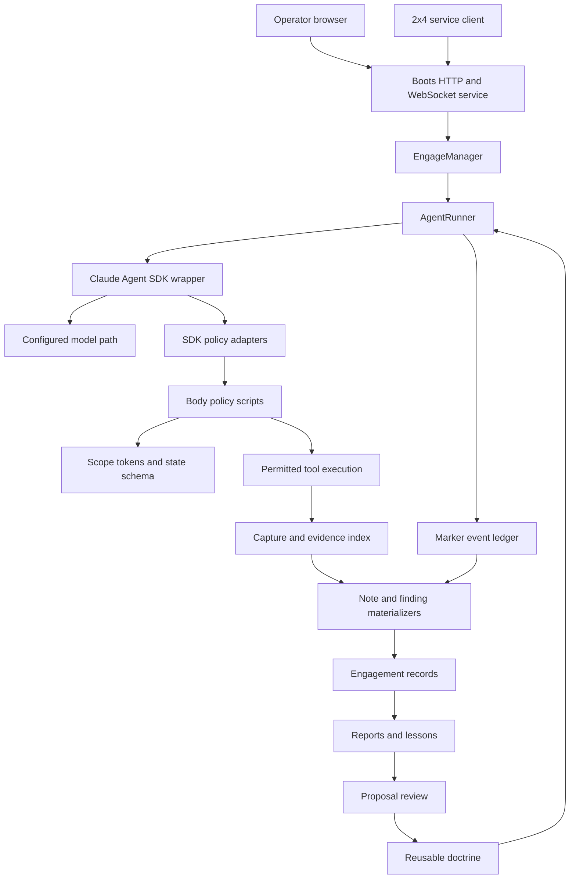
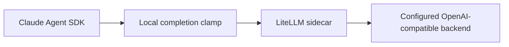

# BRA architecture

BRA separates model reasoning, operator interaction, governed execution, durable records, and reusable knowledge.
The separation is implemented through the Boots interface, Head runtime, and Body workspace.

## Responsibilities and storage

| Component | Location | Responsibilities |
| --- | --- | --- |
| Boots | `boots/` | HTTP service, browser events, scope intake, operator decisions, external integration, and managed lifecycle |
| Agent runtime | `head/bra/core/` | SDK turns, session continuation, marker dispatch, finding work, and approval recovery |
| SDK adapters | `head/bra/hooks/` | Normalize requests, call policy scripts, and translate decisions |
| Privacy engine | `head/bra/anon/` | Detection, mapping, replacement, and operator conversion |
| Model proxy | `head/bra/proxy/` | Completion limits, LiteLLM routing, and subprocess management |
| Governance assets | `body/layer1/` | Rules, policy implementations, readiness, operational scripts, and shared control libraries |
| Reusable doctrine | `body/layer2-templates/` | Methods, workflows, catalog knowledge, and report forms |
| Engagement records | `body/layer3-engagement/` | Scope, plans, notes, findings, reports, pitches, and disclosure |
| Runtime state | `body/.bra/` | Approvals, aliases, queues, phase state, artifacts, logs, and local SDK data |
| Telemetry | `body/layer4-telemetry/` | Cumulative engagement statistics |

The Body contains both reusable assets and per-engagement state.
Their lifecycle and permitted writers differ.
The numbered directories identify storage layers; they do not imply that every request follows one numbered sequence.

## Runtime connections

## Ingress and engagement routing

`boots/main.py` owns the HTTP and WebSocket routes.
The engagement socket passes recognized messages to `route_message()` in `boots/engage.py`.
The router selects scope, launch, continuation, approval, stop, report, packaging, or integration behavior.

`EngageManager` maintains the active runner, pending decisions, session identity, event history, and managed task state.
Its broadcasts update connected clients and mirror engagement events to the operational log.

The wizard writes scope and token selections through system routines.
It then prepares an engagement prompt through `agentic-handler.py`.
The target method, phase context, and host context supply the operational starting point.

## Agent execution boundary

`AgentRunner.run()` coordinates one SDK turn.
It reconciles pending findings before sending the effective prompt.
It then processes messages, tool requests, results, markers, and operator choices.

`run_agent()` supplies SDK options, allowed tools, registered hooks, model selection, local state paths, and the current working directory.
On the first normal turn, it prepends `body/CLAUDE.md`.
The `PreCompact` hook reinjects that governance text during SDK compaction.

The permission callback in the SDK wrapper returns allow.
The registered hooks and body policy routines carry the application control decisions.
This makes the actual enforcement path identifiable in source.

## Authority and policy boundaries

The hook registry installs the stop check, tool approval, finding guard, command adapter, file adapters, and post-tool capture.
Different tools enter different branches after the shared checks.

| Boundary | Input | Decision or output |
| --- | --- | --- |
| Tool approval | Tool name, input, and invocation identifier | Approval match or structured block |
| Command adapter | Bash tool request | Script review, body guard result, or block |
| Body command policy | Command and engagement state | Activity, scope, operation, path, and privacy decision |
| File adapter | Normalized file tool request | Structured body policy result |
| Body file policy | Tool, path, content, and state | Permitted write/read operation or policy denial |
| Finding guard | Pending documentation state and tool request | Normal assessment work or restricted documentation path |

The file policy response contains `decision`, `reason`, `policy`, and optional `meta`.
The adapter rejects missing, invalid, or timed-out guard responses.
The command policy uses return codes and structured reasons for approval recovery.

The SDK wrapper locates process state under `.bra/` without changing the host user's operating-system permissions.
The runtime does not configure an operating-system sandbox.
Its hooks mediate the registered SDK tool families.

`Read`, `Grep`, `Glob`, `Write`, and `Edit` enter the native file policy.
`Bash` enters script review and native command policy.
Other enabled tools receive the shared hooks and post-tool capture, without the Bash target extractor.
The SDK callbacks can continue after an earlier callback returns a block.
Bash therefore previews approval before running its own policy routine.

The runtime schema defines agent-writable, append-only, operator-only, and system-only state paths.
The file guard also applies engagement allowlists and specific privacy read restrictions.
These are application policy mechanisms for governed request paths.
The file adapter blocks missing or invalid guard responses.
The Bash adapter allows the remaining SDK invocation when its guard or Python executable is missing.
It blocks timeouts and other nonzero guard results.

File-tool rules do not become universal shell filesystem controls.
Bash output policy uses recognized write syntax and restricted path strings.
The [Control in Depth guide](control-in-depth.md) maps each resource to its effective checker.

## Privacy boundaries

The mapping file connects aliases with original values.
Scope review and chat preparation select masking behavior from the current privacy mode.
The operator can review proposals and add manual values.

Mapped command execution crosses a separate boundary.
The body guard evaluates the original command, then resolves known aliases, executes locally, and masks the result.
It attempts to record the masked artifact and provenance.
Target extraction precedes substitution and selects one recognized target.
A word-only alias can skip target validation because extraction returns no target.
No second scope check evaluates the substituted command.
Its block-style response prevents the original SDK tool call from repeating that execution.

Operator views can replace aliases for display.
The standalone report conversion utility provides the final operator output path.
Each of these paths uses the same mapping relationship but has a different purpose.

## Evidence and materialization boundaries

The post-tool hook captures nonempty results and adds evidence index records.
Capture identifiers connect requests, raw artifacts, and later observations.

The runner parses structured markers and resolves their provenance.
It ranks originating evidence above derivative inspection captures when selecting the supporting record.
It writes normalized marker events before replaying them into notes and findings.

The finding materializer creates scaffolds and deterministic evidence sections.
The documentation worker adds analysis fields.
The enforcer checks record requirements and applicable local artifact hashes before dequeuing a complete finding.

Event records and materializers give the durable output an explicit creation path.
A chat paragraph, capture, lead, finding, and final report remain different objects.

## Reporting and growth boundaries

Close-out loads required metadata and the optional finding selection.
It runs statistics, report preparation, disclosure generation, model enhancement, and lessons generation.
The manager exposes retry and skip choices when a step fails.

Incremental improvement and retrospective growth use engagement artifacts to prepare proposals.
The operator reviews the proposed values.
Promotion routes accepted checklist items into supported reusable destinations.

Ingestion provides related entry points for approved pitch content and imported references.
It is not a mandatory intermediate step for every promotion.
Reusable override recommendations remain separate from active engagement overrides.

## Model routing

The standard model path uses the Claude Agent SDK connection.
When proxy routing is enabled, the SDK base URL points to a local completion-clamp listener.
That listener forwards the request to the local LiteLLM process.
LiteLLM translates the request for the configured OpenAI-compatible backend.

The sidecar binds its listeners to loopback.
The configured model map selects the backend model name.
Completion limits are fixed configured maxima rather than a per-request remaining-context calculation.
Usage records come from SDK result messages.

## Recovery and continuity

The manager cancels stale managed tasks before replacing a runner.
It can terminate SDK child processes that belong to the server process tree.
Session identifiers support resumed model context.
Browser reconnection restores the manager's state, available history, and pending approval view.

The runner reconciles completed finding records and leftover worker output before another turn.
A stalled documentation task can trigger a restricted main-agent handoff.
Denial returns the engagement to operator choices without retrying the denied action.

Durable scope, evidence, findings, and reports remain in the Body workspace.
Active WebSocket connections, pending futures, and takeover leases belong to the running server state.

## Source-level reading path

1. Read `boots/engage.py` for lifecycle and operator decisions.
2. Read `head/bra/core/agent.py` for SDK setup.
3. Read `head/bra/hooks/registry.py` for policy registration.
4. Read the command and file adapters with their body policy scripts.
5. Read `runner.py` for provenance, finding work, and continuation.
6. Read the materializers and `finding_enforcer.py` for durable records.
7. Read report and promotion routines for close-out and reusable knowledge.

The [source map](source-map.md) links those files to their relevant functions.
