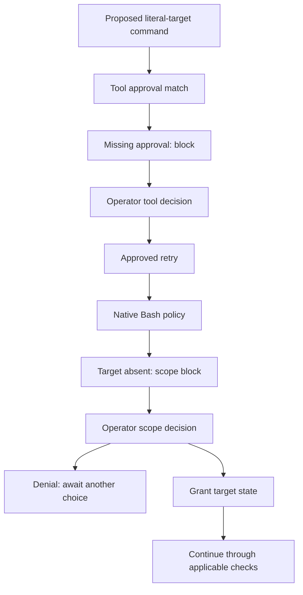

# Control in Depth

BRA places checks around specific operations, state changes, and record transitions.
The controls start with the paths and tool requests that the application manages.
They extend through target decisions, operator approvals, evidence capture, finding acceptance, and reviewed knowledge transfer.

The design separates four questions:

1. What does the model propose?
2. What does this request path permit?
3. What evidence did the operation produce?
4. What conclusion or reusable change can the engagement accept?

Each question has a different owner.
A model instruction supplies direction.
A policy predicate can refuse a matching request.
A capture records a result.
A record validator evaluates specified acceptance conditions.
The operator decides scope, exceptions, interpretation, and distribution.

## Start with the actual execution boundary

The current runtime uses the Claude Agent SDK.
`run_agent()` supplies the working directory, allowed tools, local state environment, and registered hooks.
Its SDK permission callback returns `PermissionResultAllow`.
The registered hooks carry BRA's application policy decisions.

The wrapper places Claude configuration, project state, temporary files, and XDG directories under `body/.bra/`.
This gives SDK state an engagement-local location.
It does not change the launching user's operating-system permissions.
The wrapper does not configure an operating-system sandbox, separate user, or network namespace.

A control therefore applies where its named adapter or routine receives the operation.
SDK file tools and SDK Bash use different policy paths.
A tool process does not acquire a universal filesystem or network restriction merely because its SDK request passed a hook.

Sources: [SDK options](../head/bra/core/agent.py#L80), [local state environment](../head/bra/core/agent.py#L35), [hook registry](../head/bra/hooks/registry.py#L57).

## The layers, from operations to accepted knowledge

This order describes responsibility from the lowest application boundary upward.
It is not the order in which every callback executes.

| Layer | Boundary | Concrete decision |
| --- | --- | --- |
| Workspace placement | SDK environment | Put normal SDK state under the engagement directory. |
| File operations | SDK file tools | Resolve paths and apply tool-specific read or write policy. |
| Shell references | Recognized Bash text | Check selected path tokens and output patterns. |
| Alias execution | Local mapped Bash path | Substitute values, execute, mask output, and suppress duplicate SDK execution. |
| Activity | Recognized command classes | Apply active-testing settings and matching tokens. |
| Target | Extracted command target | Check accepted target sources and the resolved scope level. |
| Operation | Matched command patterns | Require applicable destructive, installation, push, or scan authority. |
| Invocation approval | Non-exempt SDK requests | Match the operator's invocation, retry, or session permission. |
| Stop and task state | Managed tool events | Apply stop state and pending-documentation rules. |
| Model guidance | Prompt and method context | Explain scope, exclusions, methods, and required conduct. |
| Observation | Tool output | Save captures and their source metadata. |
| Record acceptance | Finding document | Check required content and applicable evidence references. |
| Operator authority | Managed decisions | Approve, deny, revise scope, review reports, and select distribution. |
| Knowledge transfer | Reviewed pitch content | Route accepted proposals into reusable destinations. |

These layers reinforce each other without having identical coverage.
A matching tool approval can release an invocation while a later target predicate still refuses it.
A successful capture can support a finding while an incomplete finding record remains pending.
A completed finding can inform a report while publication still needs operator review.

## File operations protect specific resources

The file adapter handles `Read`, `Grep`, `Glob`, `Write`, and `Edit`.
It sends normalized input to `body/layer1/hooks/file-guard.py`.
The guard resolves relative paths against the Body root.
`Path.resolve(strict=False)` also resolves existing symbolic links before write policy selection.

### Write and edit decisions

The Body guard applies these rules to the resolved destination:

- `layer1/` rejects `Write` and `Edit`, without a token override.
- Ordinary engagement writes must remain under `.bra/` or `layer3-engagement/`.
- `layer2-templates/` checks its path-matching approval before the remaining containment rules.
- A matching framework-development prefix can release containment and the template-specific check.
- Engagement root files and subdirectories must match the allowlist.
- `SCOPE.md` rejects normal writes after `SCOPE-CONFIRMED` exists.
- `.bra/artifacts/` accepts work products, subject to finding-like content checks.
- `.bra/.claude/` accepts SDK scratch `Write` requests, while direct `Edit` requests are refused.
- Declared governance state and unknown `.bra/` write destinations are refused.

A template-write token alone does not bypass the later containment predicate.
Trusted promotion routines perform their own direct writes within a temporary template-write scope.
Their write path differs from an ordinary SDK `Write` request.

The guard also checks whether intelligence entries lack their corresponding finding records.
This can block other engagement writes until documentation catches up.

### Retained content

For protected notes and report files, the guard compares a `Write` request's byte count with the current file size.
A smaller replacement is refused.
An equal or larger replacement passes this particular check.
`Edit` does not receive the resulting complete file, so this size check permits it.
These are growth checks rather than a comparison of the old and new content prefixes.

### Selected read restrictions

Direct file requests for `.bra/anon_map.json` are refused.
Reads and searches that resolve into `.bra/.claude/` are also refused.
The latter can contain unmasked SDK session material.

Other reads do not inherit the write containment rule.
The Head filesystem helper also has separate system-code write rules.
Those rules apply to callers that use that helper.

Sources: [path resolution](../body/layer1/hooks/file-guard.py#L98), [write policy](../body/layer1/hooks/file-guard.py#L382), [read policy](../body/layer1/hooks/file-guard.py#L560), [Head helper](../head/bra/core/filesystem.py#L80).

## Bash has a separate command policy

`pre_bash()` receives the proposed command string.
It first previews tool approval because later SDK hooks can run after an earlier hook returns a block.
It then recognizes selected script-execution forms and checks the script's approval path.
The native Body guard receives the original command after these adapter checks.

### Path screening

When tool approval is enabled, its Bash path screen examines selected absolute paths and parent-directory references.
It resolves detected candidates against the configured BRA roots.
The screen runs after exempt commands and session-approved requests.
Simple allowlisted commands, internal `layer1/` paths, and session matches take earlier branches.

The Body output check recognizes redirects, output flags, copy or move forms, and related write patterns.
It searches those commands for configured restricted path strings.
These include `/tmp/`, `/etc/`, home-directory prefixes, and `../`.
Project-local Claude scratch writes have a specific exception.

These checks inspect command text.
They do not apply the file guard's complete resolved-path policy to every filesystem action inside a shell process.
For example, the Body check does not reject every relative write to `layer1/`.
The SDK file-tool immutability rule and Bash command-pattern rules have different coverage.

### Activity classification

The Body guard recognizes configured network-testing patterns such as `nmap`, `masscan`, and selected web fuzzers.
It also recognizes static tools and localhost patterns.
A static match passes this activity gate.
A localhost match is not classified as remote network activity here.

Recognized remote network activity uses the selected setting:

| Setting | Decision |
| --- | --- |
| `YES` | Pass the activity gate. |
| `NO` | Refuse the recognized network test. |
| `ASK` | Require active-testing approval. |
| Missing or unrecognized | Use `ASK`. |

A command outside these patterns does not receive this activity classification.
Other command checks still apply.

### Operation and scan authority

The dangerous-operation check matches configured command patterns.
Examples include destructive file commands, selected container-escape forms, forced Git changes, and remote code execution patterns.
Recognized system installations require their installation token.
Virtual-environment and user-install matches have earlier branches in this installation check.

The first matching dangerous pattern determines that check's token requirement.
A separate aggressive-scan check recognizes selected `nmap` flags, `masscan`, and netcat forms.
It accepts a matching scan-class approval file or general active-testing approval.

The Bash helper generally reads these tokens from environment variables and `.bra/approvals/` files.
The central token library additionally supports ROE markers for routines that call it.
The active-testing helper has its own ROE-marker branch.
A token's acceptance therefore depends on the particular checker.

Sources: [Bash adapter](../head/bra/hooks/bash_hook.py#L63), [path candidates](../head/bra/hooks/tool_approval_hook.py#L218), [activity gate](../body/layer1/hooks/bash-guard.py#L370), [operation tokens](../body/layer1/hooks/bash-guard.py#L621), [output check](../body/layer1/hooks/bash-guard.py#L758), [scan check](../body/layer1/hooks/bash-guard.py#L787).

## Target validation uses concrete extraction rules

The native Bash guard selects one target from the original command.
It searches for a CIDR first, then an IPv4 address, then a URL host or standalone domain.
Domain selection uses a recognized suffix list and excludes selected package hosts.
Simple local commands can bypass extraction.
When extraction returns no target, the target gate has no target to evaluate.

The approval predicate accepts an original target, a discovered target record, or a boundary-matched literal in `SCOPE.md`.
It also accepts addresses covered by matching CIDR records.
The scope text check examines the whole document.
It does not distinguish included targets from exclusions or examples in separate sections.

Scope-level precedence is also specific:

1. Original target matches resolve to `FULL`.
2. Literal scope text or its CIDR membership resolves to `FULL`.
3. A discovered target or CIDR supplies its stored level.

A `NONE` result refuses interaction.
A `LIMITED` result first rejects configured active patterns, then permits configured passive patterns.
An unmatched operation at that level is refused.
A `CUSTOM` result currently passes this operation predicate without parsing a custom operation list.

Target registration can synchronize a `LIMITED` entry into `SCOPE.md`.
That literal can then take the earlier `FULL` branch.
The recorded level and its effective resolution must therefore be read together.

These predicates refuse concrete recognized requests.
Model-visible exclusions and arbitrary command behavior do not acquire equivalent enforcement through the literal matcher.

Sources: [extraction](../body/layer1/hooks/bash-guard.py#L427), [approval](../body/layer1/hooks/bash-guard.py#L515), [level precedence](../body/layer1/hooks/bash-guard.py#L543), [operation level](../body/layer1/hooks/bash-guard.py#L571), [scope synchronization](../body/layer1/scripts/approve-target.py#L151).

## Alias resolution is a local execution boundary

The mapping connects a model-visible word with its original value.
The guard evaluates the original command before calling `_anon_intercept()`.
A matching intercept then substitutes values in URL tokens and standalone command tokens.
It preserves alias fragments in local artifact filenames.

The substituted command runs through a local shell with captured output and a timeout.
The intercept replaces known real values in that output.
It attempts to save the masked artifact, last-capture record, and evidence index entry.
The returned `ANON_INTERCEPT_OK` message includes the process exit code and a bounded preview.
That label identifies interception, including when the process returned a nonzero exit code.

The hook returns a block-style result after this local execution.
This prevents the original SDK invocation from executing it again.

Target validation does not run again after substitution.
A word-only alias can produce no recognized target before substitution.
An operator should read the alias mapping and effective target policy as separate parts of the execution path.

Missing mappings, unreadable mappings, or `ANON-DISABLE` release the original command from this intercept.
The remaining SDK invocation then follows its normal execution path.

Source: [local substitution and execution](../body/layer1/hooks/bash-guard.py#L1003).

## Tool approval has explicit defaults and lifetimes

Tool approval is enabled unless `BRA_TOOL_APPROVAL=0` or `.bra/TOOL_APPROVAL_DISABLED` disables it.
The following tools are exempt from its ordinary invocation prompt:

`Read`, `Glob`, `Grep`, `Write`, `Edit`, `TaskOutput`, and `ToolSearch`.

Simple allowlisted Bash commands and recognized internal `layer1/` command prefixes are also exempt.
Exemption from this prompt does not remove applicable file or Body command checks.
`WebFetch` and `WebSearch` receive the shared approval checks.
They do not enter the Bash target extractor or native file policy.

| Authority form | Match and lifetime |
| --- | --- |
| Invocation approval | A `TOOL-<tool_use_id>` file is checked and deletion is attempted. |
| Retry approval | A file matches the tool and essential input fields; deletion is attempted after matching. |
| Allow once | An in-memory retry match expires after 30 seconds. An invocation file can also be created. |
| Session Bash permission | The exact command string is retained in memory. |
| Other session permission | The selected tool type is retained in memory. |
| Script permission | A path-derived approval file persists until revoked or removed. |
| Engagement capability | A matching token remains available until its source changes or is removed. |
| Scope decision | Target registration persists the selected target record. |
| Engagement override | Managed override state retains its matching conditions and decision history. |

These are distinct mechanisms.
Script approval is not tied to a content hash.
A visible once-only choice does not make every related capability token single-use.
The Body checker must recognize the location in which its permission was stored.

Absent matching tool approval blocks non-exempt requests.
A failed grant cannot supply the missing matching state.
The UI and runner then retain a decision or report the failure through their normal control path.

Sources: [approval matching](../head/bra/hooks/tool_approval_hook.py#L702), [runner grants](../head/bra/core/runner.py#L2347), [script approval](../head/bra/core/approval.py#L881).

## Stop and finding state constrain managed work

The stop hook checks `BRA_STOP=1`, `.bra/STOP`, and the recognized status block in `CLAUDE.md`.
The native Bash guard repeats the stop check before its command path.
No approval token overrides an active stop predicate.
These checks govern managed tool events rather than every host process.

The normal finding guard reads the pending queue.
With pending findings, it permits read tools and selected finding-document writes while refusing other tool work.
A missing or unreadable queue allows this guard to continue.
An active finding subagent releases the normal queue block.
The documentation hook set omits that guard because its task is to complete the finding.

Findings handoff adds a narrower file-tool and path check when its state is active.
The documentation task also receives a reduced tool list.

The SDK hook registry lists priorities, but callbacks do not form a guaranteed short-circuit chain.
Bash explicitly repeats the approval decision before its own checks.
The Body guard repeats stop state.
The alias execution routine does not repeat the pending-finding predicate.

Sources: [stop hook](../head/bra/hooks/killswitch.py#L64), [finding guard](../head/bra/hooks/finding_guard.py#L33), [documentation hooks](../head/bra/hooks/registry.py#L27), [handoff scope](../head/bra/hooks/tool_approval_hook.py#L342).

## Worked refusal: an absent literal target

Consider this proposed command:

```text
nmap -sn 203.0.113.20
```

Use these conditions for the trace:

- Tool approval is enabled.
- The installed hooks and native Bash guard are present.
- Stop state is clear, and no pending finding blocks assessment work.
- Active testing is `YES`.
- No alias mapping affects this command.
- `203.0.113.20` is absent from original targets, discovered targets, and all scope text or CIDR coverage.

The following sequence occurs before any scan runs:

1. The SDK proposes the Bash invocation.
2. The non-exempt tool request has no matching approval.
3. The approval hook returns `TOOL_APPROVAL_REQUIRED`.
4. Bash's approval preview also refuses the request before calling its Body guard.
5. The runner creates a blocked operation and presents the tool decision.
6. The operator can deny it or grant a matching tool approval.
7. On an approved retry, the Body activity check passes because the setting is `YES`.
8. The target extractor selects `203.0.113.20`.
9. The approval predicate finds no matching target source.
10. The guard returns exit code 2 with `SCOPE_CHECK_REQUIRED` and `TARGET=203.0.113.20`.
11. The Bash adapter returns a tool block. The scan has not executed.
12. The manager presents the separate scope decision.

A tool approval has therefore not changed scope.
If the operator denies the scope decision, the manager returns to ordinary choices without retrying the command.
When decision history is active, `OVERRIDES.md` records the denial.
The Body guard also attempts to write its block log.
No scan-result capture exists because no scan ran.

If the operator chooses `NONE`, registration can preserve that decision without adding the target to scope text.
A subsequent recognized request resolves `NONE` and is refused.
If the operator chooses `FULL`, registration updates target state and scope text.
The manager then continues with the updated scope context.
A later request still passes through its applicable tool, activity, operation, and output checks.



Sources: [native scope refusal](../body/layer1/hooks/bash-guard.py#L1098), [operator processing](../boots/engage.py#L1238), [registration](../head/bra/core/approval.py#L486).

## Evidence and records add later control

A permitted operation and an accepted finding remain separate transitions.
`PostToolUse` attempts to log tool metadata and capture every nonempty result.
The alias intercept supplies a separate capture path for locally executed mapped commands.
Capture identifiers and hashes connect later records with their source artifacts.

Generic post-tool masking applies to saved artifacts when the map can be read.
The hook returns an empty result and does not replace the SDK's tool response.
Capture and log errors are handled as best-effort failures.
They do not retroactively refuse a completed operation.

The runner normalizes recognized markers and their capture references.
Materializers create intelligence, leads, finding scaffolds, and evidence sections.
The finding enforcer then checks required sections, metadata, placeholders, hash format, and applicable local artifact hashes.
It also checks proof files or inline command content.
An invalid record remains pending.

These checks establish document and reference conditions.
They do not execute every proof command or independently establish the meaning of every vulnerability claim.
The operator reviews the interpretation, severity, impact, and intended report use.

Sources: [post-tool capture](../head/bra/hooks/post_hook.py#L511), [finding validation](../head/bra/core/finding_enforcer.py#L1482), [queue release](../head/bra/core/finding_enforcer.py#L2281).

## Publication and growth retain distinct authority

Report preparation compiles engagement records into the selected outputs.
The operator reviews the result and its intended distribution.
Close-out routines expose failed steps and continuation choices.
A generated report is not an automatic publication action.

Improvement proposals remain engagement content until reviewed.
The promotion routine selects checked items that lack an `IMPLEMENTED` marker.
It routes supported sections into reusable tool, skill, method, attack-pattern, or override-recommendation destinations.

The trusted routine creates a temporary template-write token when none exists.
It removes the token it created when the operation finishes.
A pre-existing token remains in place.
Checked pitch state represents acceptance in this path; the routine does not independently authenticate the person who checked it.

Reusable recommendations remain separate from active engagement exceptions.
A new engagement still needs its own scope, permission state, and evidence.
This separation lets useful lessons persist without treating prior permission as new authority.

Sources: [promotion selection](../body/layer1/lib/promotion.py#L454), [temporary token scope](../body/layer1/lib/promotion.py#L88), [override recommendations](../body/layer1/lib/promotion.py#L374).

## Installed behavior and failure decisions

| Condition | Current behavior |
| --- | --- |
| File guard missing or invalid | File adapter blocks. |
| File guard times out or exits unsuccessfully | File adapter blocks. |
| Bash guard missing | Bash adapter allows its remaining SDK invocation. |
| Bash guard interpreter missing | Bash adapter allows its remaining SDK invocation. |
| Bash guard times out | Bash adapter blocks. |
| Native Bash guard returns nonzero | Adapter blocks; intercepted execution uses a block-style result too. |
| Target state unreadable | Guard uses available scope text; an extracted unmatched target is refused. |
| No target extracted | Bash target predicate is skipped. |
| Pending finding state missing or unreadable | Normal finding guard allows. |
| Alias map missing or unreadable | Alias intercept releases the original command. |
| Capture write fails | Completed tool flow continues. |
| Finding validation fails | Finding remains pending. |

The installed adapters, selected modes, and available state define the effective control surface.
Read the [governance guide](governance.md) for operational settings.
Read the [source map](source-map.md) for the related implementation paths.

## Verification references

The repository includes focused checks for the boundaries described here:

| Tests | Exercised behavior |
| --- | --- |
| [Native file guard](../tests/test_file_guard_python_native.py) | Immutable paths, containment, confirmed scope, privacy reads, request shape, and permitted artifacts. |
| [Native Bash guard](../tests/test_bash_guard_python_native.py) | Scope requests, alias substitution, masking, captures, and protected state paths. |
| [Bash dispatch](../tests/test_bash_hook_dispatch.py) | Native dispatch, missing guard behavior, and approval before interception. |
| [Approval dispatch](../tests/test_approval_dispatch.py) | Backend target registration and failed grants. |
| [Target registration](../tests/test_approve_target_python_native.py) | Scope-grant consumption and persistent target updates. |
| [Finding artifacts](../tests/test_finding_enforcer_artifact_resolution.py) | Local evidence resolution and record requirements. |
| [Post-tool masking](../tests/test_post_hook_anon_masking.py) | Masking in saved capture artifacts. |

Read these checks alongside the predicates.
A passing example establishes its exercised behavior rather than coverage of every possible command form.
