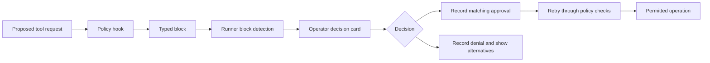

# End-to-end flows

BRA's mechanisms are most useful when read as connected transitions.
This guide follows scope, operator authority, privacy, evidence, findings, reports, and reusable knowledge through the current runtime.

## Flow 1: Scope to a running engagement

### 1. Collect the work boundary

The browser sends scope data through the engagement interface.
The wizard records authorization, target details, included work, exclusions, and selected operating tokens.
The readiness path checks the engagement structure and available tools.

**Owner:** `route_message()`, `_run_wizard()`, and `_wizard_submit()` in `boots/engage.py`.

### 2. Apply the selected privacy path

The scope review process can propose mappings from regex detection and optional local NER.
The operator approves values through the privacy interface.
Raw or masked processing follows the selected scope mode.

A known address can therefore appear in governed context as a word alias.
The alias still identifies the same scope target.

**Owner:** `anon_detect()` and `anon_apply()` in `boots/main.py`, with `AnonAPI` and `AnonMap`.

### 3. Create scope and permission state

The scope writer produces the structured engagement file.
The token writer records the selected settings under `.bra/approvals/`.
Scope confirmation changes the later file policy for `SCOPE.md`.

**Owner:** `_write_scope_file()` and `_save_token_states()`.

### 4. Select methods and phase context

The target classifier resolves the supported method family.
The loader extracts phase headings, objectives, techniques, and deliverables.
The phase invoker writes phase context for the engagement.

This supplies task-specific guidance while keeping token resolution and policy logic in their own components.

**Owner:** `target_type_detector.py`, `methodology_loader.py`, `phase_invoker.py`, and `agentic-handler.py`.

### 5. Prepare the managed agent

The manager aligns the selected Body path, starts the optional model proxy, and creates the runner callbacks.
The runner sends the effective prompt through the SDK wrapper.
The wrapper registers hooks and supplies engagement-local SDK state paths.

**Owner:** `EngageManager._prepare_runner()`, `AgentRunner.run()`, and `run_agent()`.

## Flow 2: A blocked action becomes an operator decision

Consider a tool request that needs additional permission.
The scope and tool input remain associated with that request during review and continuation.

### 1. Evaluate the request

The tool approval hook checks whether the request needs approval or matches existing permission.
Bash requests also enter script and command policy checks.
File requests enter the corresponding file policy adapter.

### 2. Return a typed reason

A missing tool approval produces identifiers and command context for the runner.
An extracted target absent from accepted scope sources produces `SCOPE_CHECK_REQUIRED`.
Other blocks identify a missing token or prohibited path.

### 3. Preserve the blocked operation

The runner converts the reason into a `BlockedOperation`.
The manager presents the relevant card and retains the pending decision.
Operator views can include rehydrated values and alias highlights.

### 4. Record the selected authority

The operator can grant a matching approval, select an available scope level, or deny the request.
Tool matching can use the invocation identifier or input-based retry record.
Target registration uses the governed scope-grant path.

### 5. Continue through the correct path

After approval, the runner retries or continues with updated scope context.
The policy hooks still evaluate the next request.
A denial returns to normal operator choices without repeating the denied command.
The decision history records the outcome.

**Key source path:** `tool_approval_hook.py` → `BlockDetector` → `EngageManager._process_approval_result()` → `ApprovalManager` → runner continuation.

## Flow 3: A mapped command produces evidence-backed records

Assume the operator has mapped the approved target to the alias `blanket`.
The agent proposes a command using that alias.

### 1. Preserve the target identity

The engagement instructions treat `blanket` as a known target.
The agent uses the alias directly instead of asking to discover a replacement address.

### 2. Evaluate authority

The original command enters the relevant approval and recognized command checks.
The scope, operation class, output destination, and active assessment mode remain separate questions.
The scope predicate needs an extracted target.
A word-only alias can yield no target at this point.

### 3. Resolve the local execution value

The command guard finds a mapped word in the command.
It substitutes the original value and runs the command locally.
It does not repeat target validation on the substituted command.
The model-facing command remains associated with the alias.

### 4. Mask and capture the output

The intercept applies the mapping to the result.
It saves the masked artifact, capture context, and evidence index entry.
It returns an `ANON_INTERCEPT_OK` preview through a block-style hook response.
That response prevents the original SDK invocation from running the command again.

Normal non-intercepted tool responses use the post-tool capture path.
That path also saves nonempty output and its evidence metadata.

### 5. Resolve an observation's provenance

The agent emits a structured service, endpoint, target, lead, or finding marker.
The runner resolves its explicit capture identifier or source hints.
Origin ranking helps select the collection request rather than a later read of its output.

### 6. Persist the normalized event

The marker event includes corrected fields and capture references.
The runner then replays events into notes and findings.
The same event can drive a durable record and a browser update.

### 7. Complete a finding

For a finding marker, the enforcer creates a queue entry and scaffold.
System-managed sections derive artifact references, hashes, line spans, reproduction information, and evidence support files.
The documentation worker supplies the remaining analysis fields.

### 8. Validate and expose the record

Validation checks required content, placeholder resolution, applicable local hashes, and proof references.
A complete finding leaves the pending queue.
The operator can inspect the finding and its source artifact from the interface.

**Key source path:** `_anon_intercept()` → capture index → `_effective_provenance()` → marker ledger → materializers → `FindingEnforcer`.

## Flow 4: Findings become reports and reusable improvements

### 1. Collect close-out metadata

The end-intake path gathers the report and engagement metadata required for the selected outputs.
When enabled, finding selection records the operator's chosen set.

### 2. Generate operational summaries

The close-out routine runs `stats.py` and `report-ready.py`.
The report routine reads the finding records and current report selection.
It creates severity tables, report structure, and the required profile data.

### 3. Prepare disclosure outputs

`disclose.py` creates the requested vendor, CNA, and disclosure material.
The templates preserve distinct evidence, reproduction, contact, timeline, and data handling fields.

### 4. Enhance and review the reports

The report enhancement routine completes narrative sections.
The manager checks for remaining placeholders.
A failed step offers retry or skip choices.
The operator reviews the final content and intended distribution.

### 5. Record lessons

The lessons routine combines engagement context, methods, findings, open leads, review gaps, and current results.
It starts growth proposal generation and the applicable override-review processing.

### 6. Derive a compact improvement

The incremental and retrospective paths identify reusable values.
Examples include a missing tool note, a method gap, a recurring technique, or an override recommendation.
The proposal records the candidate within the engagement.

### 7. Review the candidate

The operator marks the item as approved, denied, or deferred.
Approval makes it eligible for the relevant promotion path.
It does not itself rewrite every reusable asset or enable an engagement exception.

### 8. Promote to the appropriate destination

The promotion routine reads approved items and selects the supported category.
It opens the temporary template-write scope, writes the destination, and records implementation status.
The temporary token is removed when the operation finishes.
Method drafts and attack-pattern scaffolds can then receive the required technical authoring.

### 9. Use the retained value

A later engagement consults the reusable catalog through its selected methods and tools.
It receives the reviewed knowledge while retaining its own scope, permissions, alias map, and evidence.
The new engagement remains a separate work boundary.

**Key source path:** `_run_end_engagement()` → report routines → lessons → growth pitch → operator review → `promote_from_pitch()`.

## Flow 5: External assistance stays within an engagement interface

A 2x4 client uses separate service authentication.
Its summary, file, and log requests accept bounded resources rather than arbitrary file paths.

For takeover, the controller requests confirmation and creates a limited-duration lease.
Action requests must present the active lease.
The controller parses supported actions and sends them through the existing engagement router.
Scope mutation approvals are denied in takeover mode.

Call actions select the configured OpenClaw or installed Hermes voice integration.
The telephony runtime manages the provider-specific call and media behavior.
Stand-down invalidates the lease and resets the takeover state.

The [2x4 guide](2x4.md) describes configuration, routes, and call controls.

## Data records across the flows

| Record | Written by | Used by |
| --- | --- | --- |
| `layer3-engagement/SCOPE.md` | Scope writer and governed target registration | Prompt context, scope validation, and reports |
| `.bra/approvals/` | Operator and approved system routines | Token and policy checks |
| `.bra/anon_map.json` | Operator privacy paths | Masking, local substitution, and operator conversion |
| `.bra/artifacts/raw/` | Capture and privacy-intercept routines | Evidence resolution and finding support |
| `.bra/logs/evidence_index.jsonl` | Capture routines | Provenance lookup and review |
| `.bra/logs/marker_events.jsonl` | Runner marker dispatch | Note and finding replay |
| `.bra/pending_findings.json` | Finding enforcer | Documentation work and reconciliation |
| `layer3-engagement/NOTES/` | Materializers and governed documentation paths | Review, reports, leads, and growth |
| `layer3-engagement/pitches/` | Growth and improvement routines | Operator review and promotion |
| `layer2-templates/` | Reviewed authoring and promotion routines | Future engagement context and reusable references |

Paths in this table are relative to `body/`.
