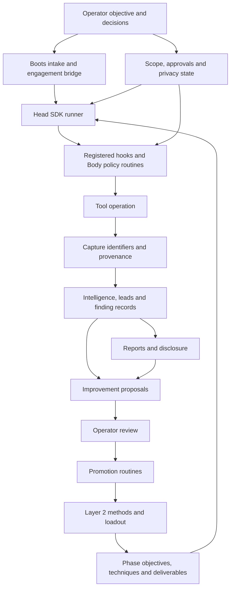
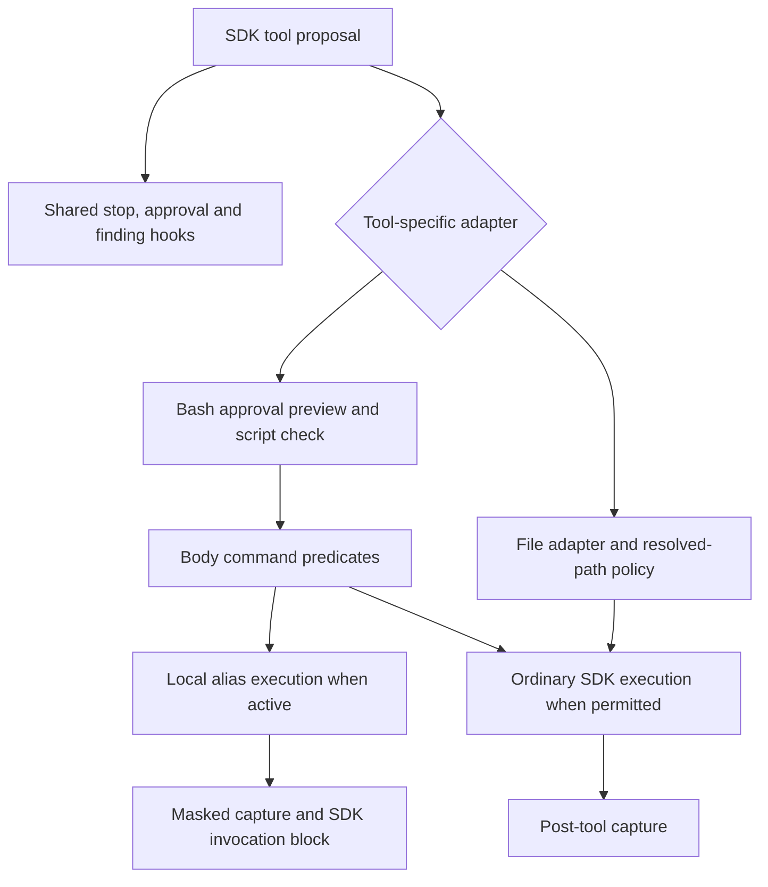

# Ready Armor in Battle Ready Armor

Ready Armor makes control and retained knowledge part of consequential AI work.
BRA applies that approach to security assessment.
It deploys directly on the host without requiring a separate virtual machine or container.

The operator brings an objective and decides the authority for the engagement.
The model supplies reasoning. Assessment tools supply operational capability.
BRA connects their work to scope, permissions, privacy, evidence, review, and reusable methods.

The value continues after a command returns.
A result can become an evidence reference, a finding record, a report section, and an accepted method improvement.
Each transition has its own conditions and owner.
An approval for a command does not settle the finding or grant permission for a future assessment.

## What makes the composition distinctive

BRA combines control of current work with retention of what the team learns.
The same engagement connects four relationships:

| Relationship | How BRA connects it | Why the connection matters |
| --- | --- | --- |
| Operator intent to action | Scope and approval state feed checks on managed requests. | The operator can resolve a specific request while retaining separate target and activity decisions. |
| Sensitive target to useful work | A selected privacy mode maps values to aliases. Local execution can resolve them. | The agent can continue using a target identifier through the supported masking path. |
| Observation to finding | Captures, provenance records, markers, queues, and validation produce durable records. | Review can examine the evidence behind a claim and identify unfinished documentation. |
| Engagement experience to future method | Proposals route accepted lessons into reusable knowledge files. | Later work can use the recorded technique without inheriting the previous engagement's permission. |

The relationship between these parts matters as much as each part's function.
A privacy map must remain useful when a command needs a real destination.
A tool result must remain identifiable when a later finding cites it.
A method improvement must remain separate from the authority for an active target.
BRA supplies the records and transfer paths that connect these decisions.

This also places useful knowledge outside the model's context window.
Scope, findings, unresolved leads, evidence references, and accepted methods remain inspectable files or managed state.
A fresh model turn can receive context from those records.
A later reviewer can examine them without needing the original conversation in memory.

## Why the layers are separate

BRA gives the current engagement and reusable knowledge different homes.

| Part | Role in the design | What changes through it |
| --- | --- | --- |
| [Layer 1](../body/layer1/README.md) | Policy routines, readiness checks, and lifecycle controls | Decisions about managed operations and record transitions |
| [Layer 2](../body/layer2-templates/) | Reusable methods, workflows, skills, tools, and document forms | Knowledge selected for reuse |
| Layer 3 | Scope, notes, findings, reports, and proposals for the current engagement | The assessment record |
| Runtime state | Approval files, alias mappings, queues, captures, and session identifiers | The state needed to operate and resume work |

A selected method supplies phase objectives, techniques, tool status, token status, and deliverables.
The phase context makes those instructions available to the agent.
Layer 1 routines and registered SDK hooks apply their implemented checks to the resulting requests.
The method describes how to investigate. Its availability does not grant a new target or activity permission.

The same separation governs improvement.
A technique learned in Layer 3 can become a proposal for Layer 2.
Accepting that proposal changes reusable knowledge through the promotion route.
The next engagement still receives its own scope, privacy settings, and operating permissions.

This arrangement lets a team retain practical experience as inspectable material.
A tool setup note can remain available after the operator who discovered it leaves.
A method can receive a better sequence without changing model weights.
A model backend can change through the supported adapter while the engagement retains its evidence and decisions.

## How the parts carry authority and evidence

Boots carries the operator's scope intake, configuration, decisions, and live view into the engagement.
Its engagement manager connects the browser to Head's SDK runner.
Head receives phase context from the selected Layer 2 method and the current Layer 3 records.
Registered hooks call the applicable Body routines around managed tool requests.

A decision flows forward to an operation.
Its result flows back through capture and provenance into materialized records.
Those records support findings, reports, disclosure, and improvement proposals.
Reviewed promotion returns selected knowledge to Layer 2 for later phase context.

The connections are explicit in the source:

| Connection | Implementation |
| --- | --- |
| Interface to agent turn | [Engagement manager](../boots/engage.py) and [SDK wrapper](../head/bra/core/agent.py) |
| Method to active work | [Phase context generation](../body/layer1/lib/phase_invoker.py) |
| Request to policy decision | [Hook registry](../head/bra/hooks/registry.py) and Body guard routines |
| Tool output to evidence | [Post-tool capture](../head/bra/hooks/post_hook.py) and [capture provenance](../head/bra/core/capture_provenance.py) |
| Marker to operational record | [Notes materializer](../head/bra/core/notes_materializer.py) and [finding materializer](../head/bra/core/findings_materializer.py) |
| Engagement to reusable knowledge | [Growth proposals](../body/layer1/scripts/growth.py) and [promotion routing](../body/layer1/lib/promotion.py) |

This flow gives three kinds of state different lifetimes.
An invocation approval can apply to one request or its matching retry.
An evidence record remains with the engagement for review and reporting.
An accepted method can remain available across engagements.
The transfer between them preserves useful knowledge without converting it into a permanent operational grant.

## BRA within Ready Armor

Ready Armor names the shared architectural approach: separate reasoning from authority, then connect controlled work to evidence and reusable knowledge.
BRA implements that approach for operator-led security assessments.
The operator sets the engagement direction and handles consequential review decisions through the assessment lifecycle.

Agent Ready Armor (ARA) applies the approach to governed autonomous agent tasks.
ARA composes task loadouts and controls through its own Armory, runtime, policy, and equipment model.
Each product implements its own control interfaces.
BRA's Head, Body, and Boots architecture supplies the assessment methods, records, and promotion paths described here.

## Capability and authority

Capability describes what a model or tool can do.
Authority describes what this engagement permits it to do.
BRA stores authority in scope records, approval tokens, target decisions, privacy modes, and controlled state files.

The agent receives some of that information as context.
Policy adapters and body scripts use it when evaluating tool operations.
The same engagement can therefore expose an instruction to the model and apply an independent runtime check to its action.

| Question | Authoritative record or component |
| --- | --- |
| What is being assessed? | Engagement scope and target records |
| Is active network work permitted? | Active assessment mode and applicable tokens |
| Can this tool request continue? | Tool approval state and policy checks |
| Can this target be added? | Operator scope decision and governed target registration |
| Where can output be written? | File policy, engagement allowlists, and runtime schema |
| Which values are masked? | Privacy mode and operator-controlled alias map |
| Is a finding complete? | Finding record validation and evidence references |
| Can a lesson become reusable knowledge? | Reviewed proposal and promotion path |

The model does not become the owner of these records merely because it can describe them.
Their effective protection comes from the specific request path and its checker.
For example, the SDK file guard refuses direct writes to approval state.
The Bash path uses its own command patterns rather than applying every file-tool rule to shell activity.

## Build the design from the resource upward

BRA runs its interface, SDK runtime, and policy programs as host processes.
A Python virtual environment can hold dependencies; it does not create a separate resource-access boundary.
The SDK process receives engagement-local configuration and temporary paths.
It retains the host permissions of the user who launched it.
BRA's wrapper does not create an operating-system sandbox.

The concrete operation decisions come from policy programs and the state they inspect.
A registered SDK hook forwards a managed request to the applicable Body routine.
The routine evaluates its recognized conditions and returns a structured decision.
The adapter translates that decision into an SDK response.
This is the integration path for those checks in BRA.

Other control decisions have different owners.
Intake and readiness routines prepare the authorized engagement.
The runner preserves pending records and capture relationships.
Finding validation decides whether the documentation meets its record conditions.
Promotion routines decide how accepted proposal items enter the reusable template library.
These decisions extend control across the lifecycle, beyond the release of one tool request.

The optional proxy routes model traffic and applies output limits.
It does not supply the permission state or replace the Body policy and record routines.
The model receives instructions and context while those programs perform their specific decisions.

The next boundary is a concrete tool operation.
A file request supplies a path and operation type.
The file adapter calls a Body policy routine and translates its structured result.
The guard can therefore refuse a resolved governance path without relying on the model to obey a warning.

A Bash request supplies a command string instead.
The adapter and Body guard recognize selected paths, script forms, activity classes, targets, and dangerous operations.
Their decisions apply to those recognized forms.
A file operation hidden inside an allowed process does not automatically become a separately guarded SDK file request.

Above these operations, the system keeps several decisions independent:

| Transition | Mechanical condition or owner |
| --- | --- |
| Release a non-exempt tool request | A matching invocation, retry, or session approval. |
| Run a recognized network test | The selected active-testing setting and applicable token. |
| Contact an extracted command target | The accepted target sources and effective level. |
| Write through an SDK file tool | Resolved path, operation, content, and state rules. |
| Execute a mapped command locally | The intercept's mapping and activation conditions after original-command checks. |
| Accept finding documentation | Required record content and applicable evidence references. |
| Distribute a report | Operator review and the selected delivery procedure. |
| Reuse an improvement | Accepted pitch content and the promotion route. |

This is the Control in Depth argument.
Each layer asks about the transition it can actually observe.
An approval for one transition does not supply missing evidence or authority for another.
The resulting engagement can preserve both the decision and the material that informed it.

Read [Control in Depth](control-in-depth.md) for the complete boundary analysis and worked refusal.

## Pattern 1: Privacy Mask/Rehydrate Layer

A selected privacy mode can replace real values with reusable word aliases.
For example, an address can become a word in the scope and model-facing context.
That word remains a usable target identifier during the engagement.

BRA separates three views:

- **Model view:** Context and records use aliases where the active mode requires them.
- **Execution view:** The local command path resolves aliases when the real value is required.
- **Operator view:** The interface can show original values and identify the rehydrated portions.

For a mapped Bash command, the guard performs the substituted execution itself.
It masks the captured output and returns a preview through the hook response.
The original SDK invocation is blocked so that it does not execute the command again.

This makes privacy part of the execution flow.
The map provides continuity between reasoning about an alias, acting on a real target, and reviewing the resulting evidence.

The current modes have specific behavior.
`MAP-SCAN` reuses known mappings. `ANON-SCAN` reviews newly detected chat values.
Scope review supports regex detection and optional local named entity recognition.
The [privacy guide](privacy.md) explains each mode and the operator conversion procedure.

## Pattern 2: Governance Token Plane

The token plane makes permission inspectable outside a conversation.
A component can check a token or approval record without asking the model whether the operator agreed.

BRA uses several forms of authority state:

| Form | Typical purpose |
| --- | --- |
| Engagement capability token | Permit an activity class or select an operating mode |
| Single-use tool approval | Permit a matching invocation |
| Retry approval | Match a tool request when the SDK assigns a new invocation identifier |
| Session approval | Retain an operator-selected permission during the session |
| Target approval | Record a target and its permitted scope level |
| Engagement override | Record a reviewed exception with matching conditions |
| Takeover lease | Permit bounded external control for a limited period |

These forms have different lifetimes.
The operator can approve one operation without creating a standing capability.
A persistent capability can affect several components while its other scope and file checks still apply.

The central token resolver checks the environment, approval files, and matching ROE markers.
The Bash guard has narrower token helpers with their own accepted sources.
The runtime also manages specific tool and retry approval records.
Read the [governance guide](governance.md) for the permission families and storage rules.

## Pattern 3: Control-in-Depth Runtime

Control in Depth combines cooperating components around consequential transitions.
The model receives policy, scope, method context, and block reasons.
External checks evaluate their tool family, recognized command syntax, selected state, and record conditions.
The installed adapters define which resources each request exposes to policy.

The SDK hook order connects these controls:

The registry supplies callback order, while SDK callbacks can continue after an earlier block.
The Bash adapter therefore repeats the tool approval decision before its Body call.
The Body guard repeats stop state before execution.
It does not repeat the finding-queue predicate inside mapped execution.

The file adapter calls a separate body policy script.
It translates that script's structured decision into the SDK response.
The command adapter similarly calls the body command guard after its approval and script checks.
File transport failures block, including a missing guard or invalid response.
The Bash adapter permits the remaining SDK invocation if its guard or Python executable is missing.
It blocks timeouts and other nonzero guard results.

The command guard extracts one recognized target from the original command.
Scope literals and original targets take `FULL` precedence over discovered target levels.
The literal matcher does not distinguish inclusion and exclusion sections.
A word-only alias can yield no extracted target.
Alias substitution occurs later, without another target check.
These selection rules define the actual scope-control boundary.

The operator remains part of the control loop.
A structured denial can become an approval card, a recorded denial, a scope decision, or a retry.
A denied operation can return to normal operator choices without repeating the action.

Control also includes managed process cleanup and context continuity.
BRA can stop or pause managed work, replace a stale runner, and restore governance context during SDK compaction.
These are operational parts of the architecture, alongside the policy checks.

## Pattern 4: Finding and Observation Materialization

Materialization means creating or updating a durable operational record from structured input.
BRA uses this boundary to separate conversation text from assessment records.

A tool response becomes a captured artifact with origin metadata.
A marker becomes an event with normalized fields and capture references.
Materializers use those events to create intelligence, lead, and finding records.

A finding then follows a more specific path:

1. Add the finding to the pending queue.
2. Create its structured scaffold and context record.
3. Derive system-managed evidence sections.
4. Complete the analysis fields through a documentation task.
5. Validate the record and its applicable evidence references.
6. Remove a complete record from the pending queue.

Validation checks structure and required content.
For applicable local artifacts, it checks file presence and the recorded SHA-256 value.
The operator reviews the interpretation, impact, severity, and report inclusion.

This boundary gives a later reviewer a concrete question: which capture supports this record?
It also supplies the inputs for report generation and reusable lessons.

## Pattern 5: Self-Growth Improvement Loop

An assessment can produce reusable knowledge as well as findings.
BRA derives improvement proposals from findings, leads, changed artifacts, tool gaps, review gaps, and override history.

The proposal belongs to the current engagement until reviewed.
Accepted items can enter the promotion path.
The promotion routine routes supported categories into tool knowledge, skills, method drafts, attack patterns, or override recommendations.

A temporary template-write token surrounds promotion work.
The routine marks processed items and removes a temporary token that it created when the operation finishes.
Method and attack-pattern outputs can be drafts that require further development.

An override recommendation remains separate from an active exception.
Promoting advice for future engagements does not turn that advice into a live bypass.

The reusable value can be small: a tool setup note, a technique description, or a method gap worth addressing.
It does not require model retraining or hidden conversational memory.

## A device assessment across the whole cycle

Consider an assessment of a network-connected device with a firmware image and an HTTP interface.
The operator records the authorized device, permitted network activity, data handling, and required outputs.
The selected method provides phases for examining the relevant surfaces.
Readiness checks examine the workspace and required engagement records before normal work continues.

The operator selects a masking mode and maps a target address to the alias `maple`.
The scope and selected context can use that alias.
The agent can propose a command such as `curl -I http://maple/` without requesting the original address.

The registered Bash hook checks the applicable invocation and script approvals.
The Body guard applies its recognized conditions to the original command.
For a mapped command, it then substitutes the real target and performs local execution.
It saves masked output with a capture identifier and returns a masked preview.
The hook blocks the original SDK invocation to avoid running the command twice.

Target extraction occurs before alias substitution in this path.
It does not repeat scope validation after substitution.
The [Control in Depth guide](control-in-depth.md) defines the recognized command forms and target rules.

Suppose the collected material supports a finding claim.
The marker pipeline connects that claim to available capture provenance.
A pending item and structured record preserve the documentation work still required.
A restricted documentation task supplies the analysis fields.
Validation checks the required content, applicable local artifact hashes, and proof references.
The reviewer then evaluates the interpretation, severity, impact, and report inclusion.

The assessment can also reveal a useful collection technique or a missing method step.
Growth routines turn engagement records into proposals for review.
An accepted tool note can enter the tool catalog.
A method change can become a draft for further development.
An accepted override recommendation remains advice until a separate engagement exception activates it.

The next operator can inspect the retained method and its rationale.
That operator does not need to recover the technique from an earlier model conversation.
The new engagement still needs its own target decisions and applicable permissions.
The team keeps the useful work while making a fresh authority decision.

## How useful knowledge accumulates

BRA's improvement loop changes files that the team can inspect, edit, version, and reuse.
It does not require retraining a model.

| Source from an engagement | Reviewable improvement | Reusable destination |
| --- | --- | --- |
| A useful tool configuration | Tool entry or setup note | `toolset.md` and related tool knowledge |
| A repeatable technique | Skill or technique description | `skillset.md` |
| A missing examination step | Method proposal or draft | Methodology library |
| A sequence that connected several observations | Attack-pattern proposal | Attack-chain drafts |
| Repeated approval friction | Override recommendation | Reusable recommendation, separate from active exceptions |

Review determines what the team keeps.
The promotion routine processes accepted checklist items and marks supported changes as implemented.
Unsupported categories can remain manual decisions.
The [promotion code](../body/layer1/lib/promotion.py) shows the routing and temporary template-write scope.

The retained value is concrete.
The next assessment can start with a documented setup step, technique, or method gap already available for review.
The team can inspect that material independently of the model provider.
It can also reject an unsuitable lesson while preserving the original assessment evidence.

## What agnostic design preserves

Agnostic design places engagement value in records and procedures that can remain when a supported component changes.
The replacement boundary matters: a reasoning backend, an agent runtime, a tool, and an interface are different components.

### Reasoning backend and agent runtime

The main assessment path constructs a Claude Agent SDK client.
It registers BRA's hooks, supplies the selected Body workspace, and preserves the SDK session identifier.
That runtime contract remains in place when the inference backend changes.

With proxy routing enabled, BRA sets the SDK's Anthropic endpoint to a local sidecar.
The sidecar uses a model mapping and configured OpenAI-compatible backend.
A configured backend can therefore supply model inference while BRA retains its engagement records and operation adapters.
The backend must support the request and tool behavior needed by the chosen workflow.

This is a specific form of model flexibility.
Using another agent framework requires an adapter that preserves the relevant operation, approval, privacy, and evidence interfaces.
Selecting Hermes or OpenClaw for 2x4 chat changes the companion assistant path, rather than the main assessment SDK.

Sources: [SDK wrapper](../head/bra/core/agent.py), [proxy configuration](../head/bra/proxy/config.py), [proxy sidecar](../head/bra/proxy/litellm_sidecar.py).

### Tools and methods

BRA works with installed assessment tools and approved scripts through the available invocation paths.
Tool knowledge records useful setup and use information.
Target-specific methods provide phases, objectives, techniques, and required deliverables.
These files can change without replacing the core record format.

The operator can select a different assessment method while retaining the same permission and capture components.
A new command still needs the applicable approvals and recognized policy handling.
A new tool integration also needs a usable output and evidence path.
The value is reusable assessment practice around the selected tools.

Sources: [tool catalog](../body/layer2-templates/toolset.md), [target-type mapping](../body/layer1/lib/target_type_detector.py), [phase context](../body/layer1/lib/phase_invoker.py).

### Interfaces and operators

Boots supplies the browser, HTTP routes, and engagement WebSocket router.
A client can present the same pending decision differently while the server retains its current engagement state.
Reconnecting browser clients receive a state snapshot and replayable events.
An authenticated service client can read named resources or request the supported actions within its authority.

Local terminal commands use the configured workspace and invoke Body routines directly.
They run as the host operator; they do not pass every management operation through the browser or SDK hooks.
This gives an operator a command interface for status, readiness, permissions, and selected lifecycle routines.
The browser Debug terminal also attaches to a host tmux session through `ttyd`.
Its trusted shell input uses host permissions, separately from the managed SDK tool path.

An operator handoff can retain scope, pending work, captures, findings, reports, and reviewed methods.
Access to the server and host workspace still determines who can operate those surfaces.
The records remain useful even when the next operator has no memory of the earlier conversation.

Sources: [terminal commands](../head/bra/cli.py), [Body script bridge](../head/bra/core/bridge.py), [Boots WebSocket handler](../boots/main.py), [interface guide](interfaces.md).

### Engagements and hosts

A target type selects a method from the reusable library.
The current engagement supplies its own scope, data handling, activity settings, and approvals.
Reusing the method carries knowledge forward while leaving the new authority decision with the operator.

The launcher creates a Python environment and uses POSIX host paths and environment conventions.
The host supplies process, filesystem, and network permissions.
Methods and records use inspectable files that can remain usable on another compatible host.
Tools, model connectivity, credentials, and runtime paths need configuration for that host.
This defines a practical portability boundary rather than a universal operating-system guarantee.

Sources: [launcher](../boots/gui.py), [workspace settings](../head/bra/config/settings.py), [installation](installation.md).

## Replaceable components and retained authority

The Ready Armor design places stable records outside the replaceable part.

| Replacement | What changes | What BRA can retain |
| --- | --- | --- |
| Model backend | Inference service and model mapping | Scope, aliases, approval records, evidence, and reports |
| Assessment tool | The executable and its command pattern | Target decisions, policy checks, artifact paths, and capture records |
| Interface | Browser, command, or external service interaction | Governed workspace and operator decision records |
| Operator | The person reviewing and directing work | Scope, recorded decisions, findings, evidence, and lessons |
| Assessment type | Target-specific methods and phases | Core permission, capture, record, and promotion mechanisms |

In the current runtime, model requests use the Claude Agent SDK.
The optional proxy translates those requests for an OpenAI-compatible backend.
A different runtime adapter must preserve the relevant policy and evidence interfaces.

The architecture separates authority from the adapter.
That separation provides a concrete basis for replacement while keeping the engagement record understandable.

## Why the composition is useful

The patterns reinforce each other through shared records.
Privacy aliases remain connected to execution and evidence.
Approval decisions remain connected to retries and audit records.
Capture provenance remains connected to findings and reports.
Reviewed findings and friction remain connected to proposed improvements.

This is the architectural distinction established in the [published preview](https://github.com/GainSec/BattleReadyArmor-PublicPreview/tree/main/docs).
The [source map](source-map.md) shows how the current runtime implements those relationships.
