# BRA interface and architecture gallery

Explore the equipment, operating controls, and records through the product views.
Open [the interactive gallery](../pages/index.html#screenshots) to inspect each full image.

## Operations

### Workflows and live engagement

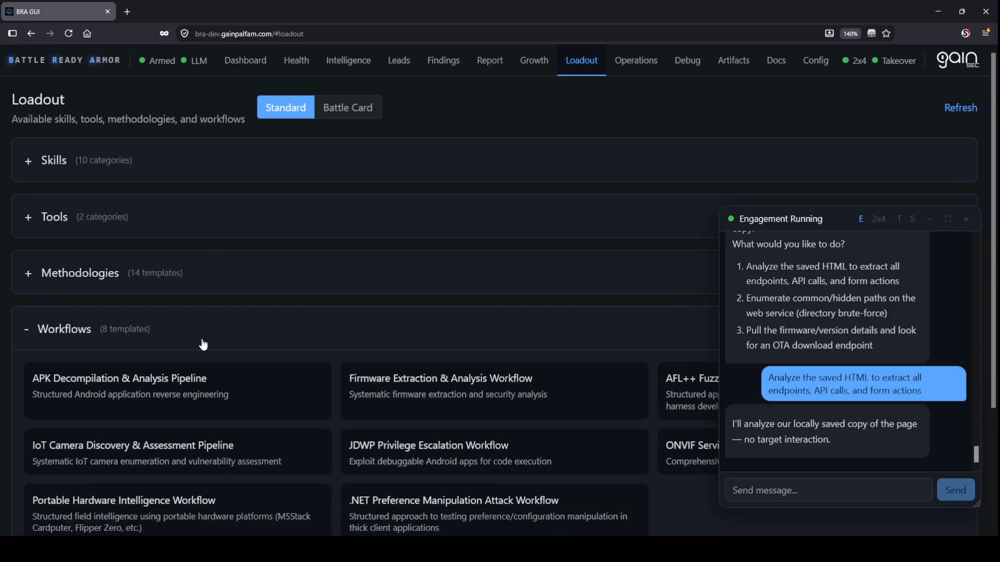

Reusable workflows remain visible beside the floating engagement conversation.

### Engagement setup

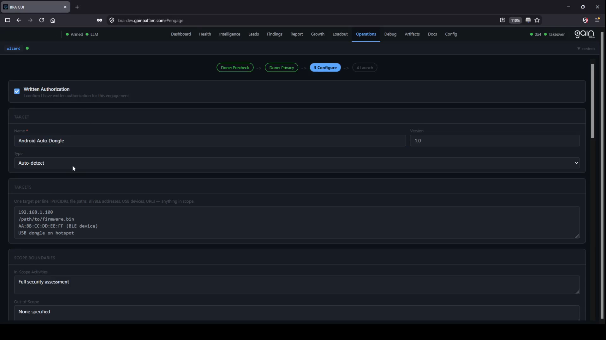

The setup form shows authorization, target details, and scope boundaries.

### Engagement scope dashboard

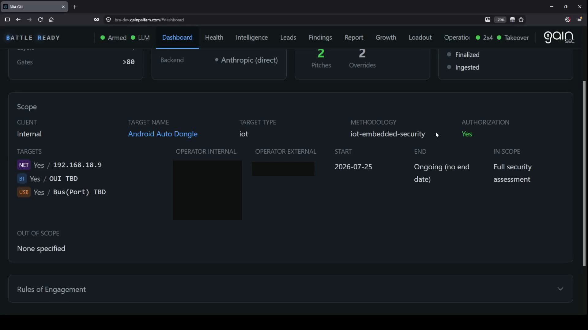

The dashboard brings target categories, methodology, scope, and authorization into one view.

## Policy and privacy

### Activity and approvals

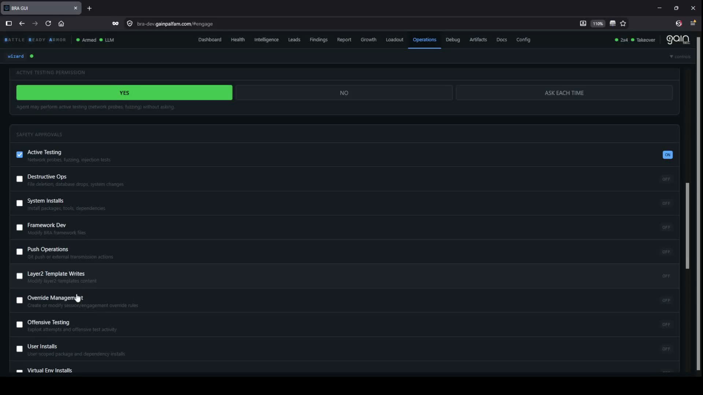

Active testing and separate approval switches appear in the engagement wizard.

### Command approval

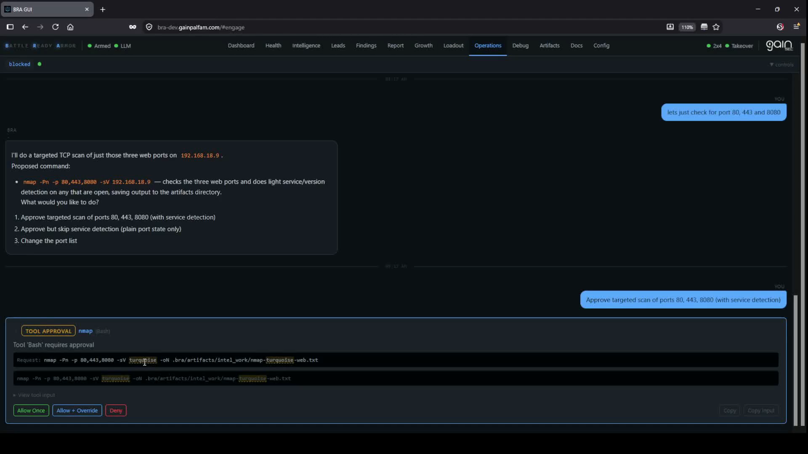

A command approval card presents the request and the available operator decisions.

### Privacy alias mapping

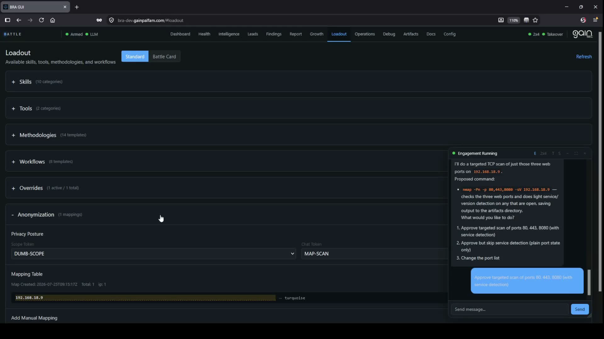

The operator mapping table connects a lab address with its reusable alias.

## Evidence and review

### Captured scan artifact

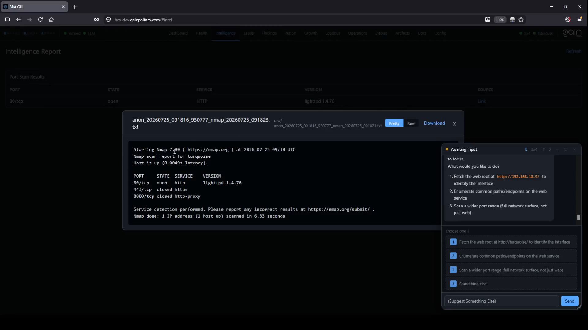

The evidence viewer displays captured scan output while the engagement conversation remains available.

### Investigation leads

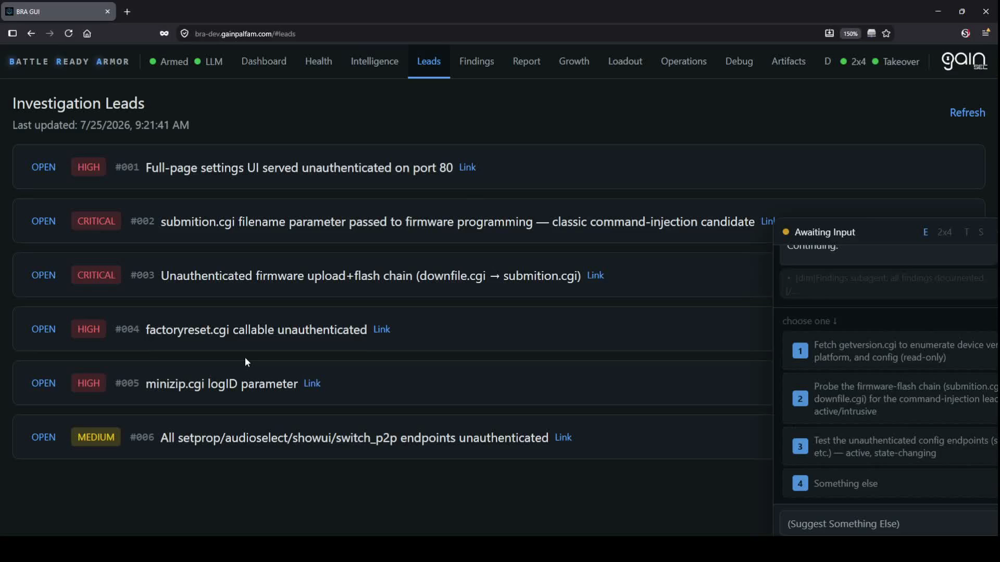

Open leads retain investigation candidates and links to their source material.

### Finding record details

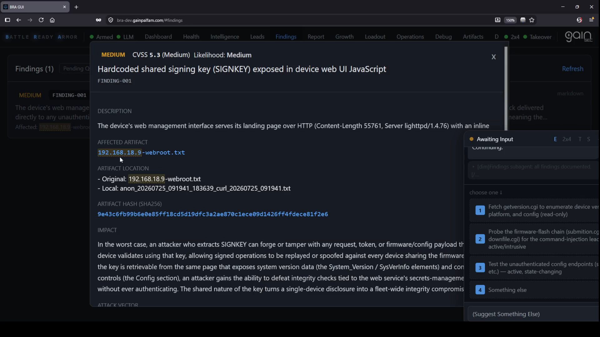

The finding view combines severity, artifact references, hashes, and impact analysis.

### Report risk summary

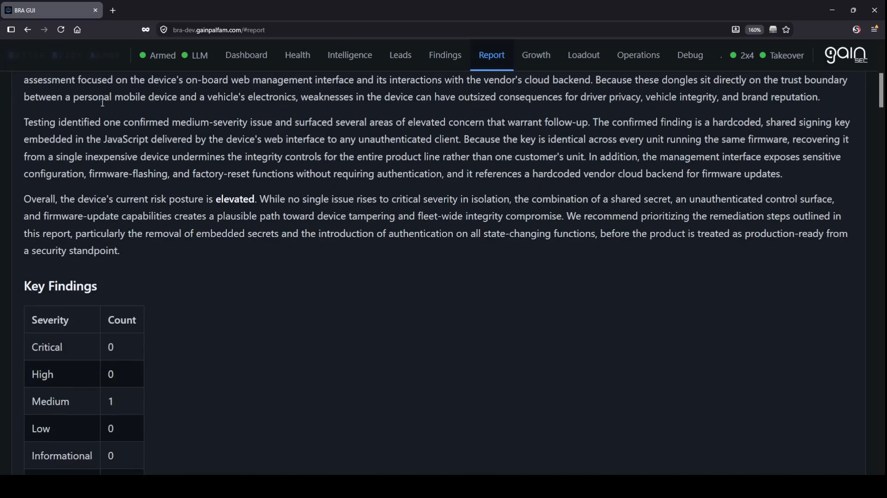

The report view combines the assessment narrative with a finding severity summary.

### Mobile artifact viewer

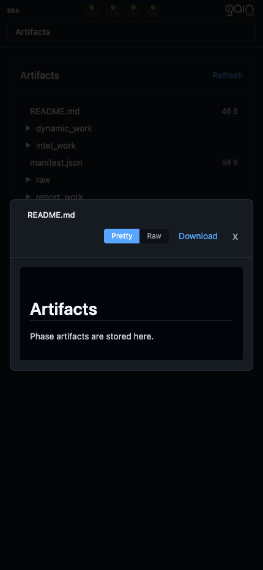

The artifact viewer presents file content with display and download controls.

## Growth

### Growth proposal review

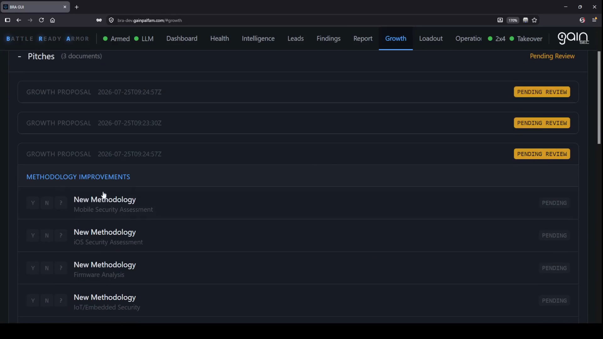

Growth proposals remain pending until the operator reviews each item.

### Growth ingestion confirmation

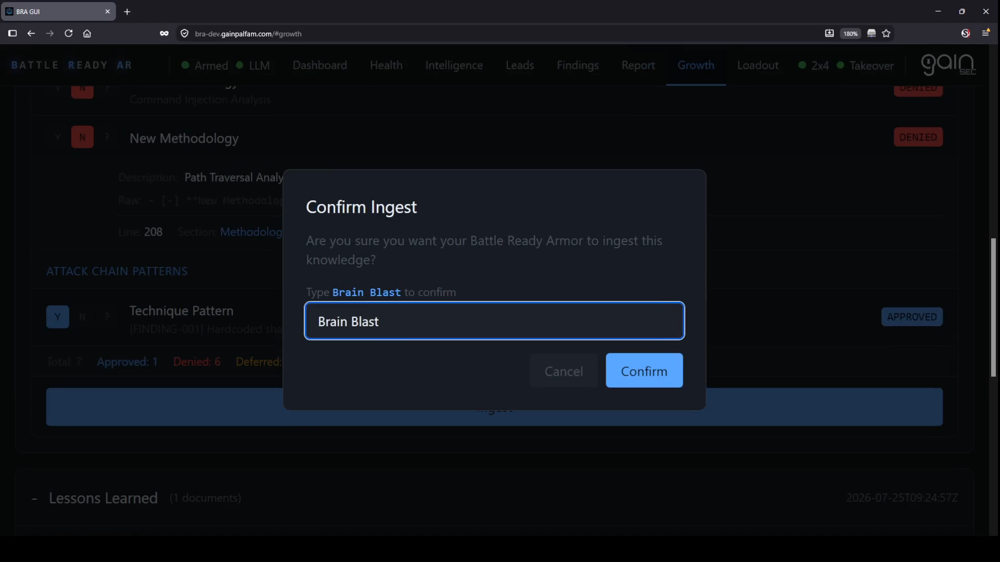

The confirmation dialog separates proposal review from knowledge ingestion.

## Mobile operations

### Mobile WebSocket controls

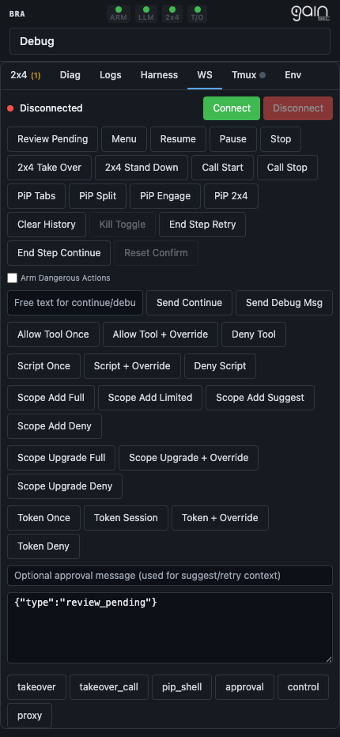

The WebSocket console groups connection, approval, scope, and lifecycle controls.

### Mobile 2x4 chat

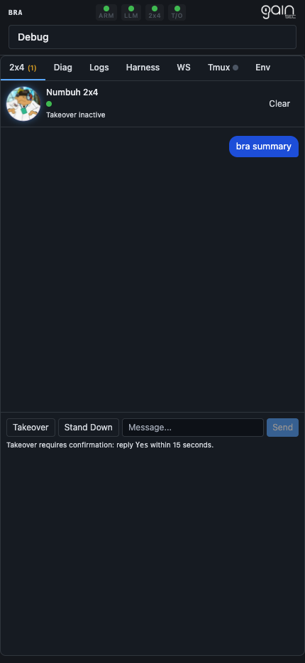

The chat view groups messages with takeover and stand-down controls.

### Mobile readiness results

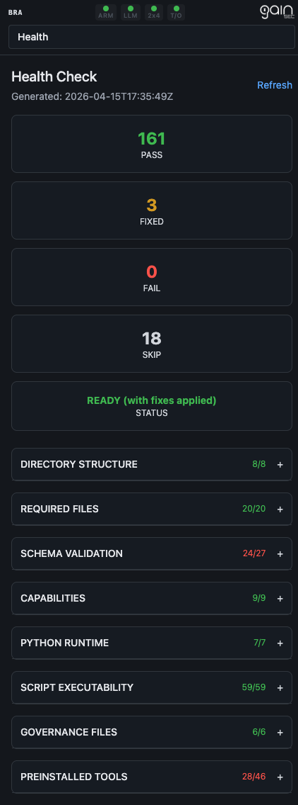

The Health view summarizes readiness results and grouped checks.

### Mobile engagement diagnostics

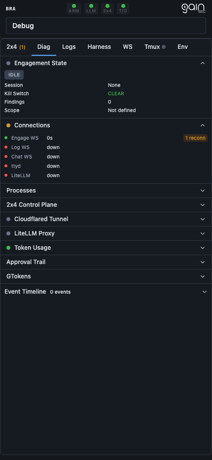

Diagnostics show engagement state, connections, and available inspection panels.

## Architecture

### System architecture

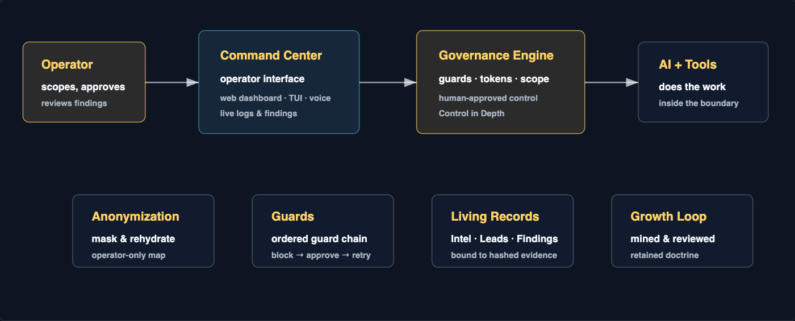

The operator works through the command center. Governance, privacy, records, and reviewed growth support the integrated agent workflow.

### Engagement lifecycle

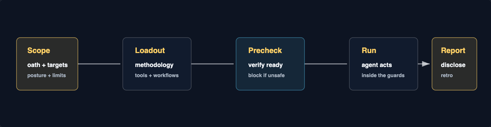

An engagement proceeds from scope and loadout through readiness checks, execution, and report preparation.
